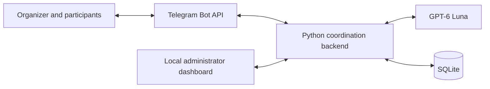

# MeetingCoordinator — Telegram

A Telegram meeting coordinator for company teams. An organizer requests a meeting in natural language; the bot privately collects availability, finds common times, asks everyone to confirm, and reports the result.

The implemented local prototype includes a browser dashboard, a Python coordination backend, GPT-6 Luna for message interpretation, and SQLite storage. Telegram uses long polling, so no public domain, webhook, or tunnel is required.

## How it works

1. An administrator adds employees and teams, then approves their Telegram enrollment.
2. An organizer messages the bot: “Arrange a 30-minute meeting with the Management team tomorrow between 10 am and 12 pm.”
3. The bot clarifies missing details and shows a preview. The organizer approves before participants are contacted.
4. Participants privately share availability. Saved context supports follow-up answers and corrections.
5. The backend checks time zones, working hours, and conflicts with meetings recorded by this bot, then offers common slots.
6. The organizer selects a slot. Every required participant must accept that exact proposal before the meeting is confirmed.
7. The bot sends the final details to the organizer and participants.

See the [short workflow and architecture](workflow_telegram_meetingBot.md) for a management-friendly overview.

## Architecture



Telegram delivers messages. The AI interprets natural language using conversation context; the backend validates actions, permissions, attendees, availability, and confirmations. SQLite stores the directory, linked accounts, conversation state, meetings, message queues, and recorded AI usage.

## Requirements

- **Python 3.11 or newer** on macOS or Linux. The runtime uses Unix file locking; native Windows support is not implemented.
- A Telegram bot token created through [@BotFather](https://t.me/BotFather), and its exact username.
- An OpenAI API key with billing and access to the configured model. This implementation defaults to `gpt-6-luna` and does not automatically substitute another model.
- Outbound internet access to Telegram and OpenAI.
- A company computer that stays awake and connected while coordination is running.

## Install and start

```sh
git clone https://github.com/RehanulBary/MeetingCoordinator-Telegram.git
cd MeetingCoordinator-Telegram
python3 -m venv .venv
source .venv/bin/activate
python3 -m pip install -r requirements.txt
python3 -m meetingbot web --open
```

The dashboard opens at **http://127.0.0.1:8765**. On macOS, you can subsequently double-click [Meeting Bot.command](Meeting%20Bot.command), which uses the project's virtual environment when available.

1. In **Settings**, enter the Telegram token, bot username without `@`, and OpenAI API key. Review the model, company time zone, working hours, workdays, and daily AI call limit. Save the settings.
2. In **Activity & usage**, select **Run checks**. These check connection metadata without generating an AI response or contacting employees.
3. Select **Start bot** and wait for **Online**.
4. In **Members**, add the organizer and participants. Enable **Can request meetings** for organizers.
5. Generate an invitation link for each employee and share it with that person. They open it in Telegram and press **Start** while the bot is running.
6. Independently verify each Telegram account, then approve its pending enrollment in the dashboard. Invitation links expire after one hour and do not grant access by themselves.
7. With at least two people enrolled, send the meeting request above to your bot and follow its prompts.

A fresh clone contains **no credentials, employee records, or meeting data**. The dashboard creates local settings and database files. Keep its Terminal window open; closing the browser alone does not stop the bot. Press **Ctrl+C** in the dashboard Terminal to stop the dashboard and its managed bot process.

For detailed instructions, see the [local quickstart](docs/telegram-local-quickstart.md) and [dashboard guide](docs/web-dashboard.md).

## Configuration and terminal commands

[`.env.example`](.env.example) lists all configuration options. Settings are saved locally in the ignored `.env`; blank credential fields in the dashboard preserve an existing saved value. Set your actual company workdays: Monday is `0`, Sunday is `6`.

For terminal-only setup on a fresh clone:

```sh
cp .env.example .env
chmod 600 .env
python3 -m meetingbot configure
```

`configure` prompts for credentials without displaying them. Edit the remaining `.env` settings, including your bot username, before running:

```sh
python3 -m meetingbot doctor
python3 -m meetingbot run
```

Run either the terminal bot or the dashboard-managed bot for a database. The runtime refuses a second instance using the same database.

| Command | Purpose |
|---|---|
| `python3 -m meetingbot demo` | Offline simulated meeting; no API calls or real messages |
| `python3 -m meetingbot doctor` | Check DNS, Telegram identity/webhook state, and model metadata |
| `python3 -m meetingbot doctor --ai-smoke` | Also make one small billable model call |
| `python3 -m meetingbot members` | Inspect employee enrollment and requester access |
| `python3 -m meetingbot pending` | Inspect pending account approvals |
| `python3 -m meetingbot meetings` | Inspect saved meeting states |
| `python3 -m meetingbot queues` | Inspect processing and delivery states |
| `python3 -m meetingbot usage` | Inspect recorded AI calls and token usage |
| `python3 -m meetingbot --help` | List commands, including member creation and enrollment |

Employees can use `/help`, `/teams`, `/schedule`, `/new`, `/status`, `/settings`, `/cancel`, `/stop`, `/resume`, and `/version` in Telegram. Directory access and scheduling require the appropriate company permissions.

## Costs and limits

Standard Telegram messaging and local hosting costs are described in the [local quickstart](docs/telegram-local-quickstart.md#8-costs-for-this-local-implementation). Telegram applies sending-rate limits.

**OpenAI API usage is billed separately.** Running on an existing computer avoids cloud hosting charges but still uses electricity and internet. The default `MAX_AI_CALLS_PER_DAY=100` limits this application's model-call attempts per UTC day, including failures. It is neither a Telegram message allowance nor an account-wide dollar spending cap.

Historical pricing assumptions and a calculator are available in the documentation below. Those dated examples are not a current price quote or measured production usage.

## Current scope

- One company directory, one running coordinator per database, and SQLite storage.
- All selected attendees are required; up to 20 people, a 31-day request window, and meeting durations of 5–240 minutes.
- Company-wide working hours/days and individual time zones. Requesters can select company-wide teams and members; per-team access rules are not implemented.
- Calendar synchronization, video-call link creation, recurring meetings, roster import, and optional attendees are not implemented.
- The dashboard is for a trusted operator on the local computer. It binds to loopback and has no remote login system.
- Failed or uncertain deliveries require operator review. The app does not guarantee exactly-once external message delivery.
- The computer must remain awake and connected. Saved state survives restarts; automated backups and retention purges are not implemented.

## Troubleshooting

| Problem | Check |
|---|---|
| Bot does not reply | Confirm **Online**, internet access, and an awake computer; inspect Activity and the queues |
| Employee cannot use the bot | Verify they pressed Start through their invitation and received admin approval |
| Team or person is not found | Add the directory record and check its name/team; the bot cannot contact unregistered people |
| Bot start reports a conflict | Stop any other polling instance; an existing Telegram webhook must be removed explicitly before long polling |
| Model request fails | Check the API key, billing, model access, and daily call limit |
| Dashboard port is busy | Use the existing dashboard or run `python3 -m meetingbot web --open --port 8766` |
| Code was updated but behavior is unchanged | Restart the bot and check `/version`; restart the dashboard too if its code changed |

## Development and verification

With the virtual environment active:

```sh
python3 -m unittest discover -s tests -v
python3 -m meetingbot demo
```

Tests cover scheduling, permissions, enrollment, conversation state, proposal versions, persistence, queue recovery, dashboard protections, and mocked API contracts. They do not prove live credentials or model access. Optional JavaScript syntax validation uses Node: `node --check meetingbot/web_assets/app.js`.

The separate command `python3 -m meetingbot check-conversation --live` runs up to twelve billable model calls against fictional in-memory scenarios. It sends no Telegram messages. See the [conversation guide](docs/conversation-coordination.md).

```text
meetingbot/                  Backend, AI planner, storage, Telegram runtime, dashboard
meetingbot/web_assets/       Dashboard HTML, CSS, and JavaScript
tests/                      Offline workflow and contract tests
docs/                       Setup guides and architecture/pricing proposals
scripts/estimate_costs.py    Offline calculator using supplied assumptions
workflow_telegram_meetingBot.md  Short workflow and architecture overview
```

Never commit `.env`, database files, enrollment links, private conversations, or credentials. Keep local company data and database-consistent backups protected.

## Documentation

| Guide | Contents |
|---|---|
| [Workflow and architecture](workflow_telegram_meetingBot.md) | Short overview for management |
| [Local quickstart](docs/telegram-local-quickstart.md) | Detailed setup, CLI enrollment, example coordination, and limits |
| [Web dashboard](docs/web-dashboard.md) | Settings, members, approvals, runtime controls, and activity |
| [Conversation coordination](docs/conversation-coordination.md) | Context, corrections, examples, and language checks |
| [Offline demo transcript](docs/telegram-demo.md) | Simulated end-to-end workflow |
| [Telegram implementation proposal](docs/telegram-implementation.md) | Proposed production deployment and dated pricing research |
| [WhatsApp implementation proposal](docs/whatsapp-implementation.md) | Requirements and design for a future adapter; not implemented |
| [Architecture and pricing plan](docs/architecture-and-pricing.md) | Worked examples, problems, and historical budget assumptions |
| [Channel usage plan](docs/whatsapp-and-telegram-usage.md) | Planned WhatsApp/Telegram interactions |
| [Technical reference](docs/technical-reference.md) | Original production architecture and source register |
| [Pricing assumptions](docs/pricing-assumptions.json) | Editable inputs for `python3 scripts/estimate_costs.py` |

The production proposals describe additional infrastructure and features beyond this local implementation. Their dated hosting, model, and WhatsApp estimates should be rechecked before budgeting.
