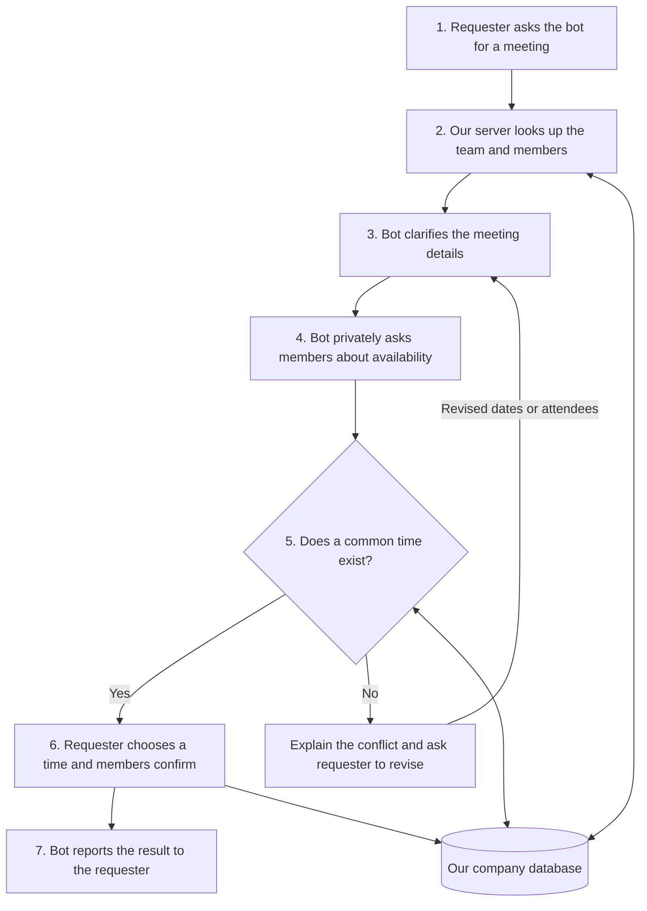

# Meeting Bot — an easy-to-read plan

**For:** our company's teams\
**Draft updated:** 10 November 2026\
**Pricing research date:** 10 November 2026

## 1. What are we building?

An employee asks the bot to arrange a meeting. The bot finds the requested team members in our database, privately asks them about suitable times, finds a common time, collects confirmation, and reports the result to the requester.

The requester and members use **WhatsApp or Telegram**. Our company server runs the bot's logic and accesses the company database.

> **Example:** “Arrange a 30-minute meeting with the engineering team next week.”
>
> **Result:** “Your engineering meeting is confirmed for Wednesday, 18 November, 2:30–3:00 PM, Dhaka time. Ayesha, Sara, and Nabil have all accepted.”

That is the successful outcome. If someone has not replied or a common time cannot be found, the bot reports that clearly and asks the requester to decide what to do next.

**First version:** agree on a time and send confirmations through chat. Creating an actual Google Calendar or Outlook event is a later feature that needs a calendar connection.

## 2. The flow at a glance

The database is updated throughout the process. It remembers the request, replies, proposed times, and confirmations so the bot can continue later.

## 3. One complete example

### Step 0 — set up the company and members

Before anyone can request a team meeting, an admin adds the team's members and links their messaging accounts.

| Person | Company role | Team | Messaging account | Time zone |
|---|---|---|---|---|
| Rehan | Authorized meeting requester | Management | Registered account | Asia/Dhaka |
| Ayesha | Member | Engineering | Registered account | Asia/Dhaka |
| Sara | Member | Engineering | Registered account | Asia/Dhaka |
| Nabil | Member | Engineering | Registered account | Asia/Dhaka |

The database also records working hours and notification preferences. WhatsApp members must have agreed to receive messages; Telegram members must start a private chat with the bot before it can contact them there. Platform details appear in sections 6 and 7.

### Step 1 — Rehan asks the bot

> **Rehan:** Arrange a meeting with the engineering team next week.

Our server checks that Rehan is allowed to make this request. It looks up “Engineering” in the database and finds Ayesha, Sara, and Nabil.

### Step 2 — the bot asks for missing details

> **Bot:** Engineering has Ayesha, Sara, and Nabil. How long should the meeting be, and must all three attend?
>
> **Rehan:** Thirty minutes. All three must attend. I am available Wednesday, 18 November, between 2 and 4 PM, Dhaka time.
>
> **Bot:** I will ask all three about a 30-minute meeting on Wednesday, 18 November, between 2 and 4 PM, Dhaka time. Shall I begin?
>
> **Rehan:** Yes.

The server saves meeting **M-104**, including Rehan's own availability, the required attendees, duration, time zone, and response deadline.

### Step 3 — the bot privately talks to each member

> **Bot → Sara:** Rehan wants a 30-minute engineering meeting on Wednesday, 18 November, between 2 and 4 PM, Dhaka time. When would you be available? Reference: M-104.
>
> **Sara:** After 2:30 is fine.
>
> **Bot:** For M-104, can you attend between 2:30 and 4 PM that day?
>
> **Sara:** Yes.

The AI helps interpret Sara's words. Our server validates the date and time, then saves the availability. The other members have their own private conversations.

These messages illustrate the desired conversation. The WhatsApp version must use approved standard wording whenever the platform requires it.

### Step 4 — the server finds the overlap

Suppose the collected availability is:

| Person | Available on Wednesday, 18 November, Dhaka time |
|---|---|
| Rehan | 2:00–4:00 PM |
| Ayesha | 2:00–4:00 PM |
| Sara | 2:30–4:00 PM |
| Nabil | 1:00–3:00 PM |

Everyone is available **2:30–3:00 PM**. That is long enough for the 30-minute meeting.

Our server calculates this overlap using scheduling rules. It records a proposed time for M-104.

### Step 5 — choose the time and confirm it

> **Bot → Rehan:** Wednesday, 18 November, 2:30–3:00 PM works with everyone's stated availability. Shall I ask the team to confirm this time?
>
> **Rehan:** Yes.
>
> **Bot → each member:** Please confirm M-104: Wednesday, 18 November, 2:30–3:00 PM, Dhaka time. [Confirm] [Suggest another time] [Decline]

**“I am available” and “I accept this meeting time” are separate responses.** The bot waits for the required members to accept the exact proposed time.

### Step 6 — report the result

If all three accept:

> **Bot → Rehan:** M-104 is confirmed for Wednesday, 18 November, 2:30–3:00 PM, Dhaka time. Ayesha, Sara, and Nabil have all accepted. Calendar event creation is not connected yet.

If Nabil has not replied:

> **Bot → Rehan:** M-104 is awaiting confirmation. Ayesha and Sara accepted Wednesday, 18 November, 2:30–3:00 PM, Dhaka time. Nabil has not replied. I will follow the reminder policy until the response deadline.

The requester can also ask, “What is happening with M-104?” The bot reads the saved status and answers.

## 4. What is stored, and can our server access it?

**Yes. Our server connects to the database using controlled credentials.** It reads team/member records and updates meeting progress. Each employee sees the information they are authorized to see.

| Stored information | Example | Why we need it |
|---|---|---|
| Employee identity | Employee ID, name, company email | Identify the right person |
| Teams and membership | Sara belongs to Engineering | Turn a team request into an attendee list |
| Linked messaging account | WhatsApp contact identifier or Telegram user/chat ID | Contact the correct registered person |
| Preferences and permission | Asia/Dhaka, working hours, notifications enabled | Ask at suitable times and respect preferences |
| Meeting request | M-104, Rehan, 30 minutes, required attendees | Remember what the requester asked for |
| Availability | Sara: 2:30–4:00 PM on 18 November | Find possible meeting times |
| Proposal and acceptance | Sara accepted M-104 proposal 1 | Track who accepted the exact time |
| Message progress | Sent, failed, response received, reminder due | Handle missing replies and delivery problems |

A phone number is needed for WhatsApp where applicable; Telegram can use its user/chat identifiers without collecting a member's phone number for the bot.

A sample record in plain language:

> **Sara / employee E-102:** Engineering; verified messaging account; Dhaka time; scheduling notifications enabled. For M-104, available 2:30–4:00 PM and confirmed the 2:30–3:00 PM proposal.

### Who does what?

| Part | Its job |
|---|---|
| WhatsApp or Telegram | Carries the conversations between people and the bot |
| Our company server | Checks permissions, looks up members, runs scheduling, and sends updates |
| Our database | Remembers people, teams, requests, availability, and confirmations |
| AI service | Helps understand messages such as “after lunch, except 3–4” |
| Company admin | Maintains teams, verifies members, and handles unresolved operational issues |

The server gives the AI the information needed for the current conversation. Database credentials stay on our server. The backend controls which records can be read or changed and which messages can be sent.

The requester receives scheduling outcomes. For example, “Sara is unavailable” is enough; the bot should keep Sara's private explanation out of the group report.

## 5. Problems we must handle, with examples

### Conversation and scheduling problems

| Problem | Example | What the bot should do |
|---|---|---|
| Missing meeting details | “Meet with Engineering.” | Ask for duration, dates, required people, and time zone before outreach. |
| Two members share a name | Two employees are named Sara. | Show their team or company identity and ask which Sara the requester means. |
| A member is unregistered | Nabil exists in the directory but has no usable bot account. | Report that outreach is blocked and give the organizer the enrollment step. Keep Nabil marked unreachable. |
| A member does not reply | Ayesha replies; Sara is silent. | Remind within the agreed limits and report Sara as pending. Silence never counts as acceptance. |
| No common time exists | Sara is free in the morning; Nabil only in the afternoon. | Ask about alternatives, then show the conflict to Rehan. Rehan decides whether to broaden dates or change attendance requirements. |
| A reply is unclear | “Tomorrow after lunch.” | Ask for the exact date, time range, and time zone before saving a definite answer. |
| Members use different time zones | Rehan says 3 PM Dhaka time; Sara is in London. | Store the same actual instant and show it in each person's saved time zone. |
| A person joins two meeting conversations | Sara replies “yes” while M-104 and M-105 are both open. | Ask which meeting she means, unless the reply is clearly attached to a specific proposal. |
| Someone changes their mind | Nabil accepts 2:30, then says he can only do 4. | Reopen scheduling and tell Rehan. If the time changes, collect fresh confirmations. |
| An optional member cannot attend | An optional observer declines. | Report the decline; proceed only if all required attendees accept and the organizer chooses to proceed. |
| The requester cancels | Rehan says “Cancel M-104.” | Verify Rehan's authority, stop reminders, mark it cancelled, and notify affected participants. |
| A member has another commitment | Sara confirms here but has an unrelated calendar event. | Explain that the first version relies on stated availability. A later calendar connection can check external conflicts. |

### Delivery and server problems

| Problem | Example | What the system should do |
|---|---|---|
| A message cannot reach a member | The bot is blocked or the account is unavailable. | Record the failure and report it to Rehan. Leave the member unconfirmed. |
| The server restarts | It stops after saving Sara's reply. | Load saved meeting progress and pending work from the database, then resume. |
| The same platform notification arrives twice | One reply is delivered to our server twice. | Recognize its unique identifier and process it once. |
| Sending has an uncertain result | The platform may have accepted a confirmation, but our server timed out. | Record the uncertainty and investigate/reconcile before sending duplicate confirmations. |
| A member gets too many reminders | Sara is involved in several requests. | Apply a daily reminder limit across requests and respect quiet hours. |
| An unauthorized person asks for data | An unknown account asks for the employee list. | Check company identity and permissions before returning company information. |

**When the bot cannot resolve a problem:** explain what is missing or conflicting, identify who needs to act, and report the current meeting status. After two negotiation rounds, or at the deadline, return the decision to the requester.

## 6. Option A — use WhatsApp

The meeting flow stays the same. We connect our server to the official WhatsApp Business Platform using a company-controlled business account and number. [Official platform overview](https://business.whatsapp.com/products/business-platform)

### What makes WhatsApp different?

- Members must agree to receive the bot's scheduling messages.
- Starting a conversation requires an approved message template: standard wording approved by Meta.
- After a member replies, the bot can send free-form replies within 24 hours of that member's latest message. Later outreach requires an approved template.
- The permission to reply within that window is separate from pricing. [Official messaging policy](https://business.whatsapp.com/policy)

**Example:** Sara last replies on Monday at 9 AM. A reminder on Wednesday requires an approved template. Sending a template does not reopen the free-form conversation window until Sara responds.

**Another problem:** Meta may classify our invitation template differently from a reminder. That affects price. We must use the approved category and verify the company's account rules before launch.

### WhatsApp pricing assumption

For Bangladesh recipient numbers, the current draft uses these **provider-reported planning figures**:

| Message | Assumed price |
|---|---:|
| Utility template | $0.0037 per delivered message |
| Marketing template | $0.0732 per delivered message |
| Service reply | $0.0037 after the reported monthly allowance |
| Reported service allowance | First 1,000 service messages per bot number per month |

These figures come from [published Bangladesh rates](https://www.msgorb.com/whatsapp-pricing/bangladesh) and the [October billing update](https://support.gupshup.io/hc/en-us/articles/62362400519705-WhatsApp-Service-Messages-Pricing-w-e-f-01-Oct-2026). Meta's accessible public overview conflicts with the provider updates, and its detailed rate card could not be retrieved during the pricing research. Treat the WhatsApp budget as provisional until checked in the company account. [Meta pricing overview](https://business.whatsapp.com/products/platform-pricing)

## 7. Option B — use Telegram

The meeting flow also stays the same. We create a company bot with BotFather and connect our server to Telegram's Bot API. [Official bot introduction](https://core.telegram.org/bots)

Each member opens a company enrollment link, starts a private chat with the bot, and verifies their employee identity. Our server saves the linked Telegram account in the directory.

**Example:** Sara has already pressed Start and enrolled. The bot can privately ask her about M-104 and send later reminders.

**Problem example:** Nabil is in the company Telegram group but has never started a private bot chat. The bot reports “Nabil needs to enroll” to Rehan. Group membership alone does not enable private outreach. [Private-chat initiation rules](https://core.telegram.org/bots#how-are-bots-different-from-users)

Ordinary bot messages are **free within Telegram's standard limits**. The sender will queue messages at a suitable rate; the pilot will leave optional paid broadcasts disabled. Hosting and AI still have their own costs. [Official messaging limits](https://core.telegram.org/bots/faq#how-do-i-avoid-hitting-limits)

## 8. What could it cost each month?

These are example running costs in **USD, before taxes and development costs**. The budget assumes an average of **five attendees**, separate from the three-member team used in the story above.

For each meeting, allow:

- 10 WhatsApp template messages and 20 conversational service replies.
- 20 AI calls at the token assumptions in the detailed reference, costing about $0.10 per meeting.
- One shared server costing $12/month plus $3.60/month for daily VM backups.

The hosting example uses [DigitalOcean's published VM price](https://www.digitalocean.com/pricing/droplets) and [backup percentage](https://docs.digitalocean.com/products/backups/details/pricing/). The AI example uses [published OpenAI model rates](https://developers.openai.com/api/docs/models/gpt-5.6-terra). Actual usage can change these costs.

| Meetings per month | Telegram: hosting + AI | WhatsApp: utility-template case | WhatsApp: marketing-template case |
|---:|---:|---:|---:|
| 20 | $17.60 | $18.34 | $32.24 |
| 100 | $25.60 | $33.00 | $102.50 |
| 300 | $45.60 | $75.20 | $283.70 |

**How to read the WhatsApp columns:** one assumes all 10 templates per meeting get the utility rate; the other assumes all get the marketing rate. They are two planning examples, rather than a guaranteed price range or maximum bill. The remaining conversation allowance is identical in both cases. Extra messages, longer AI conversations, taxes, number costs, or a messaging provider's fees can increase the total.

If the reported free service allowance is unavailable, add $1.48, $3.70, or $3.70 respectively to the WhatsApp examples. The [detailed cost breakdown](technical-reference.md#5-shared-running-costs-and-total-budgets) explains the assumptions and exclusions.

Telegram's messaging line is $0; its table totals cover our server, backup, and AI example. If both platforms are enabled, they share the same server and database. Each member should have a preferred contact platform so requests are not sent twice.

## 9. What we build first

1. **Company directory:** add employees, teams, verified messaging accounts, working hours, and permissions.
2. **One complete scheduling flow:** request, clarify, ask members, find overlap, confirm, and report.
3. **The important problem cases:** missing replies, conflicting availability, changed times, cancellation, and restart recovery.
4. **A small company pilot:** use Telegram first if the team is comfortable with it; verify real message and AI usage.
5. **WhatsApp connection:** complete account setup, template approval, and rate checks before relying on its budget.
6. **Calendar booking later:** connect the chosen calendar provider, check conflicts, and create the actual event after confirmation.

A successful pilot can coordinate a real team meeting and explain clearly when it cannot finish. The database must retain an accurate status, and the requester must always be able to see what is pending.

## 10. Detailed documentation

- [WhatsApp implementation guide](whatsapp-implementation.md): standalone requirements, setup, implementation details, pricing, problems, and validation.
- [Telegram implementation guide](telegram-implementation.md): standalone requirements, setup, implementation details, pricing, problems, and validation.
- [WhatsApp and Telegram usage guide](whatsapp-and-telegram-usage.md): company setup, member enrollment, meeting requests, replies, and troubleshooting.
- [Technical reference](technical-reference.md): component diagrams, database records, reliability rules, setup details, and full source verification notes.
- [Source verification register](technical-reference.md#7-documentation-and-verification-register): which official pages were accessible and which require account-level checking.
- [Editable pricing assumptions](pricing-assumptions.json): change the usage and rates used by the budget calculator.
- [Offline budget calculator](../scripts/estimate_costs.py): run `python3 scripts/estimate_costs.py` from the project root.

The remaining company-specific inputs are the employee roster, expected meeting volume, work schedule, available hosting, and access to the selected messaging account.
