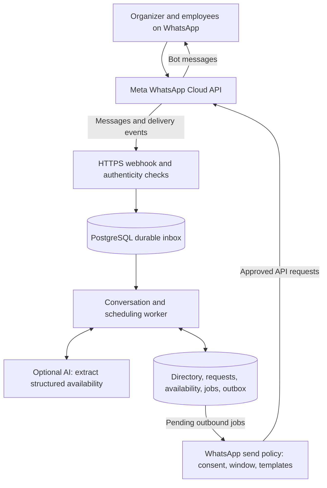
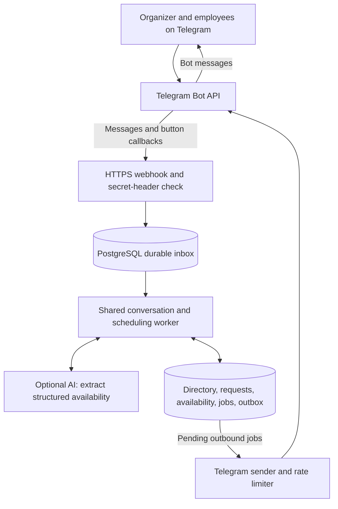
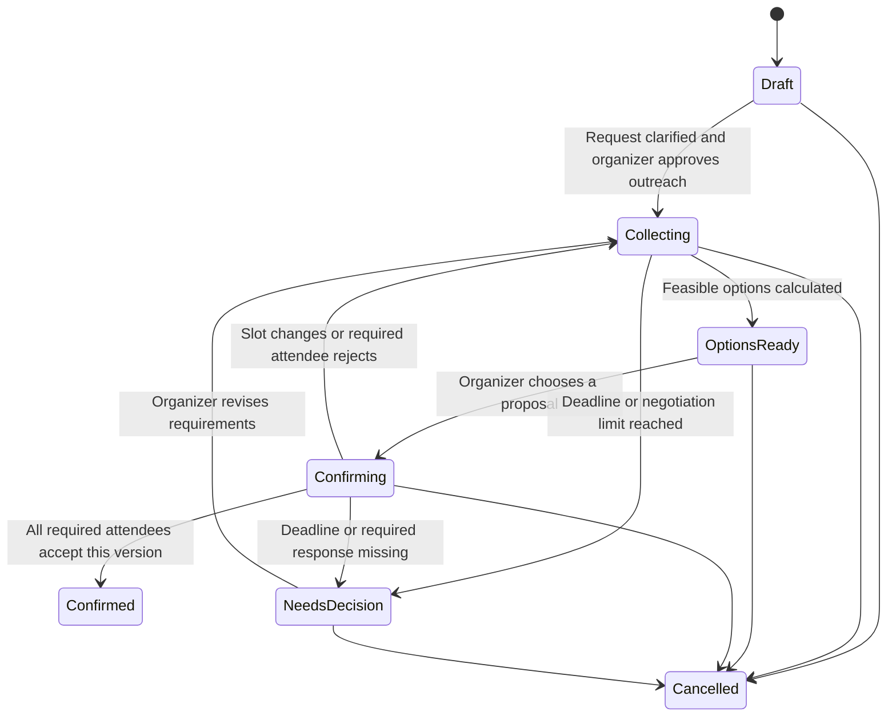

# Company Meeting Coordinator — technical reference

Start with the [plain-language plan and worked example](architecture-and-pricing.md). This reference preserves the detailed implementation design, pricing assumptions, and source verification notes.

**Prepared:** 10 November 2026\
**Scope:** one company initially; WhatsApp design first, Telegram design second\
**Status:** proposed architecture and planning budget, ready for implementation review

## 1. Product definition

An organizer asks for a meeting with named employees or a saved team. The bot gathers missing details, privately asks participants about availability, handles alternatives, and reports suitable times and unresolved responses to the organizer.

Example request:

> Arrange a 30-minute project review with the engineering team next week, during working hours.

Example report:

> Meeting M-104: Wednesday, 18 November, 2:30–3:00 PM, Dhaka time. Four of five required participants confirmed this exact slot. One reply is pending. The meeting is awaiting confirmation.

The initial product coordinates and reports. Calendar event creation is a later integration. A chat message alone does not reserve a person's external calendar.

### Initial scope and assumptions

- A manually maintained employee/team directory identifies attendees. Team names are company records, independent of messaging groups.
- Five attendees per meeting is a budgeting example, not a product limit.
- Asia/Dhaka is the initial default time zone; each employee can override it. Working days, hours, and holidays must be configured for the company.
- Participants can use suggested-slot buttons or type alternatives. Start with English; evaluate Bangla and mixed-language responses before promising support.
- Distinguish available, explicitly confirmed, declined, no response, unreachable, and opted out.
- After the organizer selects a proposed slot, obtain participants' confirmation for that exact proposal. If it changes, earlier confirmations do not carry forward.
- Report unresolved scheduling by a deadline. The organizer decides whether to change requirements or proceed without optional attendees.

## 2. Architecture A — WhatsApp

### 2.1 Integration approach

Use the official WhatsApp Business Platform Cloud API, directly from the company account. This draft does not assume a third-party messaging subscription. Meta provides both direct and partner integration routes. [Official platform overview](https://business.whatsapp.com/products/business-platform)

The first version uses individual conversations with registered employees. Existing WhatsApp groups are not an architectural dependency. This avoids making the pilot depend on Groups API eligibility, which was not verified for the company's account.



### 2.2 Request lifecycle

1. **Register employees.** Link each employee record to a verified messaging identity. Record permission to receive scheduling requests and to share availability summaries with the organizer.
2. **Receive the organizer's request.** Resolve the team; ask about ambiguous names, duration, date range, time zone, mandatory attendees, and response deadline.
3. **Preview the request.** Show attendees and exact dates before beginning outreach. This is an ordinary step in the proposed product.
4. **Ask participants.** Send the applicable approved template when required. Include the company name, organizer, meeting reference, duration, and response action.
5. **Interpret replies.** Convert natural language into validated availability intervals. Ask for clarification when a time or time zone is unclear.
6. **Find overlap and propose a slot.** Calculate options using scheduling logic. Present options and response status to the organizer.
7. **Confirm the selected proposal.** Collect acceptance of the exact date, duration, and proposal version; remind outstanding participants within configured limits.
8. **Report.** Show confirmed attendees, pending or declined attendees, and conflicts. Mark fully confirmed only when all required attendees accepted that proposal.

Illustrative template text, subject to Meta approval and classification:

> {{company}} meeting request {{reference}} from {{organizer}}: {{duration}} minutes during {{date_range}}. Please reply with suitable times, or decline. Contact {{support_contact}} for help.

Use separate, purpose-specific templates for outreach, a reminder, and a final meeting update. Templates must retain meaningful fixed context; inserting arbitrary AI-written conversations into template variables is not the proposed design.

### 2.3 Platform rules that affect implementation

Recipients must have opted in. Business-initiated conversations require approved templates; free-form replies are allowed within 24 hours of the recipient's latest message. Outside that window, use an approved template. Sending a template alone does not reset the incoming-message clock. Provide a clear route to a human contact. [WhatsApp Business Messaging Policy](https://business.whatsapp.com/policy)

**The 24-hour window is a messaging permission rule, not a guarantee that messages are free.** Pricing is evaluated separately below.

The outbound worker checks consent, the latest inbound timestamp, template status/category, quiet hours, request status, and cost budget at send time. If a scheduled free-form reply becomes ineligible before it is sent, substitute an appropriate approved template or stop and report the issue.

Meta's terms restrict some uses where offering AI technology is the primary functionality. Our intended product is a specific scheduling service, with AI assisting interpretation. Whether that deployment is accepted remains an account/platform eligibility question; this draft does not establish approval. [Official Business Solution Terms](https://www.whatsapp.com/legal/business-solution-terms/)

### 2.4 Account and integration setup

Prepare a company-controlled Meta business portfolio, WhatsApp business account, eligible business phone number, developer app, billing configuration, access credentials, and approved templates. Verify the exact onboarding requirements in the company's dashboard; do not assume business verification or app-review requirements from another account apply unchanged.

Proposed adapter configuration:

| Setting | Purpose |
|---|---|
| Business account ID and phone number ID | Identify the sending business assets |
| Access token | Authorize outbound requests; keep server-side |
| App secret | Verify webhook payload signatures |
| Webhook verification token | Complete the subscription challenge |
| Supported Graph API version | Pin a currently supported version during implementation |
| Template registry | Approved names, languages, categories, and current status |

Use a GET handler for the subscription challenge and a POST handler for notifications. Validate POST authenticity using the raw request body and `X-Hub-Signature-256`; the challenge token is a separate check. Meta's archived SDK documents these mechanics, but the archived SDK itself is not recommended as a dependency. [Meta webhook reference](https://whatsapp.github.io/WhatsApp-Nodejs-SDK/api-reference/webhooks/start/)

Persist authenticated notifications before acknowledging them. Distinguish incoming messages from delivery/status events so receipts cannot restart conversations. Follow current Cloud API documentation when selecting endpoints and permissions. [Official getting-started documentation](https://developers.facebook.com/documentation/business-messaging/whatsapp/get-started)

### 2.5 WhatsApp pricing and confidence

**Important qualification to the earlier chat estimate:** the Bangladesh prices below are reported by providers, not a rate card independently retrieved from Meta during this research.

Meta's accessible public overview states that charges depend on delivered messages, category, and recipient market. It also still describes service and certain utility replies as free. In contrast, Gupshup's dated October 2026 update describes billable service replies after a monthly allowance and billable utility templates within the service window. Meta's detailed pricing pages returned login screens or retrieval errors. These sources do not support calling the entire budget an independently verified Meta quote. [Meta public pricing overview](https://business.whatsapp.com/products/platform-pricing), [Gupshup October billing update](https://support.gupshup.io/hc/en-us/articles/62362400519705-WhatsApp-Service-Messages-Pricing-w-e-f-01-Oct-2026)

Use the following as a provisional November 2026 planning model for **Bangladesh recipient numbers**:

| Item | Planning value | Evidence status |
|---|---:|---|
| Incoming employee messages | No Meta message fee | Provider-reported billing update |
| Utility template delivered | $0.0037 | Provider-reported Bangladesh rate |
| Marketing template delivered | $0.0732 | Provider-reported Bangladesh rate |
| Service reply delivered | $0.0037 after allowance | Provider-reported Bangladesh rate |
| Service allowance | 1,000 per business phone number per month | Provider-reported October update |
| Third-party provider subscription/markup | $0 included in this design | Direct integration assumption; any chosen provider adds its own charges |

The country-specific figures come from [MsgOrb's Bangladesh rate publication](https://www.msgorb.com/whatsapp-pricing/bangladesh). The allowance and billing change come from the [Gupshup update](https://support.gupshup.io/hc/en-us/articles/62362400519705-WhatsApp-Service-Messages-Pricing-w-e-f-01-Oct-2026). Taxes, card charges, and number costs are additional where applicable.

**Do not assume a new meeting invitation will be classified as utility.** Use the category actually approved by Meta and track category changes. The utility and marketing cases below deliberately show how much this decision matters. [Official template categorization reference](https://developers.facebook.com/documentation/business-messaging/whatsapp/templates/template-categorization) — linked for implementation; its contents could not be retrieved in this session.

For one number and one recipient market, with no authentication messages:

```text
WhatsApp monthly message cost
  = utility_count × utility_rate
  + marketing_count × marketing_rate
  + max(0, service_count − free_service_allowance) × service_rate
```

Count billable delivered messages, not meetings or conversations. A production ledger should preserve recipient market, category, number, provider billing classification, message identifier, and effective rate date; reconcile it against actual account billing. For multiple markets or numbers, calculate each billing bucket separately under the actual account rules.

### 2.6 WhatsApp message-only examples

Assume **10 template messages and 20 service replies per meeting**. Ten templates represents five attendee invitations plus up to five later reminders. Twenty service replies is a separate allowance for conversations, proposals, and organizer reports. These are budgeting assumptions, not a claim that every meeting needs that many messages or that every final notice can use a service reply.

| Meetings/month | Templates | Service replies | All templates utility | All templates marketing |
|---:|---:|---:|---:|---:|
| 20 | 200 | 400 | $0.74 | $14.64 |
| 100 | 1,000 | 2,000 | $7.40 | $76.90 |
| 300 | 3,000 | 6,000 | $29.60 | $238.10 |

These are calculations from the provisional rates, before hosting and AI. A mixture of template categories falls between the two cases at these rates. Additional templates for confirmations or rescheduling increase costs. If the reported service allowance is unavailable, add $1.48, $3.70, or $3.70 respectively. Actual delivery restrictions can also prevent outreach; a higher budget does not guarantee delivery.

Before committing to WhatsApp production, verify the account's current rate card, service allowance, approved categories, and a small real billing sample. The account setup and price verification are outstanding external steps, not completed by this architecture draft.

## 3. Architecture B — Telegram

### 3.1 Integration approach

Create a standard company bot using BotFather and connect it to the Telegram Bot API. The Bot Platform is free. Each employee must initiate their private chat, normally by pressing Start, before the bot can privately contact them. Membership in a company group alone is insufficient for private outreach. [Official bot introduction](https://core.telegram.org/bots)



### 3.2 Employee onboarding and meeting flow

1. An admin registers the employee in the company directory and issues a short-lived, single-use enrollment link through a company-controlled channel.
2. The employee opens the bot and presses Start. Link their Telegram user ID and private chat ID to the employee record after verifying the enrollment code. A display name or username alone is not sufficient proof of employment.
3. Capture time zone, team, working hours, and scheduling notification preferences.
4. The organizer requests a meeting using ordinary text or `/schedule`. Resolve attendees against the same directory and preview the request.
5. Send private availability questions. Offer buttons such as “This works,” “Suggest another time,” and “Decline,” alongside free-text replies.
6. Run the shared scheduling and proposal-confirmation flow. Send progress and the final result to the organizer's private chat.

Use meeting references and proposal versions in button payloads. Deep links and inline keyboards are supported by Telegram; the employee verification process above is our proposed application design. [Telegram bot features](https://core.telegram.org/bots/features#deep-linking)

If an employee has not enrolled, the bot reports “not registered” to the organizer. It cannot independently open a private conversation with that employee.

### 3.3 Delivery and group behavior

For production, configure an HTTPS webhook with a random `secret_token`, validate the `X-Telegram-Bot-Api-Secret-Token` header, deduplicate `update_id`, and acknowledge only after durable ingestion. During local development, long polling is an alternative; use one update-receiving mode at a time. Handle flood-control responses using `retry_after`. [Official Bot API](https://core.telegram.org/bots/api#setwebhook)

Optional company-group commands can create requests or show non-sensitive progress. Keep participant availability and private reasons in private chats. Keep group privacy mode enabled unless broader access is necessary. Telegram's FAQ explains which messages privacy-enabled bots receive. [Group privacy behavior](https://core.telegram.org/bots/faq#what-messages-will-my-bot-get)

Telegram API success means a message was accepted for sending, not that the employee read it or agreed to the meeting. The organizer report relies on explicit responses.

### 3.4 Telegram pricing

Normal bot messaging costs **$0** within the standard limits. Telegram documents approximately 30 broadcast messages per second, about one message per second in a single chat, and 20 messages per minute in groups. Optional paid broadcasts increase throughput; this pilot will leave them disabled. [Official bot limits and pricing](https://core.telegram.org/bots/faq#how-do-i-avoid-hitting-limits)

Our sender will queue below the documented limits, observe returned rate-limit instructions, and retry later. No throughput upgrade is budgeted.

| Item | Telegram charge for this design |
|---|---:|
| Bot registration | $0 |
| Ordinary private meeting messages and reminders | $0 within standard limits |
| Optional company-group interaction | $0 within standard limits |
| Paid broadcast upgrade | Not enabled |
| Hosting and AI | Separate; see section 5 |

All three usage scenarios in section 5 therefore have a $0 Telegram messaging line. This does not make development, hosting, or AI free.

## 4. Scheduling service shared by both versions

This is a proposed application design. The channel changes; the scheduling rules and source of truth remain the same.

### 4.1 Components and deployment

| Component | Proposed choice | Responsibility |
|---|---|---|
| HTTP application | Python with FastAPI | Receive callbacks, verify requests, expose authenticated admin operations |
| Database | PostgreSQL | Company directory, consent, meetings, availability, durable jobs, audit records |
| Background worker | Separate process from the same codebase | Parse replies, calculate slots, send queued messages, run reminders |
| Job/outbox storage | PostgreSQL tables with leased jobs and bounded retries | Survive restarts without requiring a separate queue service initially |
| AI adapter | Replaceable model provider | Interpret requests/replies into a strict schema; ask clarifying questions |
| Messaging adapters | WhatsApp Cloud API and Telegram Bot API | Normalize events and implement each platform's sending rules |
| Runtime | One small Linux VM, HTTPS reverse proxy, supervised processes | Pilot operation with explicit resource limits and backups |
| Admin surface | Initially authenticated API/CLI | Maintain teams, link accounts, inspect failures, pause reminders |

FastAPI is documented at [its official site](https://fastapi.tiangolo.com/). PostgreSQL documents locking options such as `FOR UPDATE SKIP LOCKED`, which can support concurrent job claiming; the lease/retry design is ours. [PostgreSQL SELECT reference](https://www.postgresql.org/docs/current/sql-select.html)

The pilot places application, worker, and database on one VM. This is a cost-conscious starting point with a single point of failure. If reliability requirements grow, separate the database and workers and obtain a new hosting estimate.

### 4.2 Data model

| Record | Key fields |
|---|---|
| Employee | employee ID, active flag, company identity, time zone, working schedule |
| Team/membership | team ID, employee ID, effective membership |
| Channel account | employee ID, channel, provider user/chat identifier, verified status, preferred channel |
| Notification permission | employee/channel, scope, grant time/source, withdrawal time |
| Meeting request | reference, organizer, subject, duration, date range, deadline, state, version |
| Participant | employee, required/optional, response status, last response, reminder count |
| Availability | employee, meeting, normalized time intervals, certainty, source event |
| Proposal/confirmation | proposal version, exact start/end, employee acceptance or rejection |
| Inbox/outbox/job | deduplication key, payload reference, due time, attempts, lease, provider message ID, status |
| Usage/audit | state changes, billed categories, token usage, costs, operator actions |

Store actual instants in UTC and retain the employee's IANA time zone for display and future interpretation. WhatsApp addressing must accommodate the identifiers the account/API actually provides; do not use a raw phone number as the company's permanent employee primary key.

### 4.3 State and scheduling rules



Required rules:

- Interpret relative dates against the message timestamp and employee time zone. Show full dates before confirming a proposal.
- Intersect validated availability of required participants and require enough continuous time for the duration. Rank feasible options by optional attendance and stated preferences.
- Treat a general availability interval as permission to propose times, not an acceptance of every possible slot.
- Do not mark missing responses as available or infer acceptance from delivery/read information.
- Bind confirmations to the exact proposal version. Reject or clarify stale button presses.
- With concurrent meeting requests, present a meeting selector when context is ambiguous. Never attach “yes” to an arbitrary meeting.
- Recalculate on changed availability. Use database version checks so a late reply cannot overwrite a newer decision.
- Default reminder policy: at most one reminder per employee per day across requests, no more than two per request, only in configured working hours. Stop after decline, opt-out, cancellation, or deadline.
- Limit negotiation rounds to two initially, then report alternatives and blockers to the organizer.

### 4.4 AI boundary and reliability

The AI extracts fields such as `meeting_reference`, `intent`, `availability_intervals`, `time_zone`, and `needs_clarification`. Validate the schema and dates on the server. Schema-constrained output is available from the optional OpenAI implementation. [Official structured-output documentation](https://developers.openai.com/api/docs/guides/structured-outputs)

The scheduler, not the model, determines overlap and final state. Only server-authorized operations can send messages or update meetings. Participant text cannot grant admin rights, change recipient lists, or override company policy. Button responses and routine status reports need no model call.

Process inbox events at least once with deduplication and per-meeting concurrency control. Commit state changes and outbox records in the same transaction. Use bounded retries with backoff, dead-letter failures, and restart recovery. External delivery is not guaranteed exactly once: a timeout after provider acceptance is ambiguous, so record the uncertainty and avoid blindly resending final confirmations.

### 4.5 Privacy and operations

Show organizers scheduling outcomes, not private explanations. State this sharing behavior during enrollment and collect the applicable permissions. Exclude unrelated chats from model context. Restrict administration to company-authorized users and revoke access when employees leave.

Keep tokens and signing secrets server-side, redact them from logs, encrypt disks/backups, and authenticate admin operations. Proposed retention is 14 days for raw scheduling messages and 90 days for derived meeting/audit data, subject to the company's retention policy. Provider-side retention is separate and must be reviewed for the selected AI endpoint. [OpenAI data controls reference](https://developers.openai.com/api/docs/guides/your-data)

Track queue age, send failures, pending responses, model-token usage, template categories, and actual costs. Take database-consistent backups and verify restoration. VM snapshots alone should not be treated as a tested database recovery procedure.

## 5. Shared running costs and total budgets

### 5.1 Infrastructure example — directly verified published prices

Use a **DigitalOcean Basic Regular VM with 2 GiB RAM, 1 vCPU, and 50 GiB disk: $12/month**. This is a sizing proposal for the pilot, not a performance guarantee. PostgreSQL runs on that VM, so no managed database subscription is included. [Official VM pricing](https://www.digitalocean.com/pricing/droplets)

Daily percentage-based VM backups add **30%**, or **$3.60/month** for that VM. Infrastructure total: **$15.60/month**. [Official backup pricing](https://docs.digitalocean.com/products/backups/details/pricing/)

Reuse a company subdomain. Additional storage for database exports, extra monitoring, and any domain purchase are excluded. Existing company infrastructure could reduce the incremental hosting bill, but that is not assumed in the totals.

### 5.2 AI example — directly verified published model rates

For a reproducible example, use **GPT-5.6 Terra** at **$2 per million input tokens and $12 per million output tokens**, using ordinary text requests with short contexts. This is an optional budget reference, not a finding that it is the cheapest or required model. [Official OpenAI model pricing](https://developers.openai.com/api/docs/models/gpt-5.6-terra)

Assume 20 calls per meeting, averaging 1,000 billed input tokens and 250 total billed output tokens per call:

```text
AI cost per call = (1,000 × $2 + 250 × $12) / 1,000,000 = $0.005
AI cost per meeting = 20 × $0.005 = $0.10
```

The token counts are planning inputs, including any billable reasoning within the output assumption. Actual context length, extra clarification, retries, and model behavior can increase usage. No cached-input discounts, batch discounts, voice processing, or paid tool calls are assumed. Measure real tokens during the pilot and adjust the model and budget.

### 5.3 Monthly alternative deployments

All amounts are **USD per month, before taxes**, calculated from [the editable assumptions](pricing-assumptions.json). Shared infrastructure and AI are counted once per alternative deployment.

| Scenario | Meetings | Hosting + backup | AI | Telegram total | WhatsApp total: utility templates | WhatsApp total: marketing templates |
|---|---:|---:|---:|---:|---:|---:|
| Small pilot | 20 | $15.60 | $2.00 | **$17.60** | **$18.34** | **$32.24** |
| Company use | 100 | $15.60 | $10.00 | **$25.60** | **$33.00** | **$102.50** |
| Busy use | 300 | $15.60 | $30.00 | **$45.60** | **$75.20** | **$283.70** |

WhatsApp totals remain provisional for the reasons in section 2.5. The marketing column changes all 10 template messages per meeting to the marketing rate while retaining the same service count. It is a category sensitivity case, not a maximum possible bill. Telegram messaging is free; its totals cover our hosting and optional AI example.

For 100 meetings/month, a practical initial operating allocation is **$35/month for Telegram**, **$45 for WhatsApp if utility classification is confirmed**, or **$135 for the all-marketing case**, rounding roughly 30% above the calculated totals. These are proposed reserves, not vendor quotes or hard caps. Apply limits in the application and review provider billing; alerting alone does not stop spend.

If both channels are enabled, share the core, VM, and database. Assign one preferred channel per employee and count actual traffic on each; do not send every request twice or add two full hosting bills by default.

### 5.4 Costs excluded from these totals

- Building the product, maintaining it, onboarding employees, and supporting failures.
- Taxes, currency conversion, card/bank fees, and account-specific rates or discounts.
- A WhatsApp business number/SIM, a new domain, or any company registration costs.
- Third-party messaging provider subscriptions or markups, if introduced.
- Separate backup storage and paid monitoring beyond the quoted VM backup.
- Company calendar or video-conferencing licenses and any later integrations.

No exchange rate is assumed. Convert USD using the actual payment provider's rate when approving a BDT budget. Free trials and promotional credits are excluded.

Reproduce the arithmetic from the project root:

```sh
python3 scripts/estimate_costs.py
```

The calculator is offline, uses decimal arithmetic, and does not validate current prices or account eligibility.

## 6. Comparison and implementation sequence

| Decision | WhatsApp | Telegram |
|---|---|---|
| Private employee onboarding | Verified directory identity plus messaging permission | Verified enrollment plus employee starts private bot chat |
| Proactive scheduling | Subject to consent, templates, and account rules | After private-chat initiation, subject to platform rules and limits |
| Messaging budget | Category/market-dependent; provisional values documented | $0 at ordinary pilot throughput |
| First-version group dependency | None | None; optional commands in groups |
| External account setup | Business assets, number, templates, billing | BotFather registration and token |
| Shared application work | Directory, AI interpretation, scheduling, persistence, reminders, reports | Same |

**Recommended build sequence:** implement the shared core and Telegram pilot first if the team will use Telegram. Add WhatsApp after account onboarding and template/rate validation. The design above still supports WhatsApp as the first deployed adapter if employee adoption favors it.

1. **Company setup:** finalize roster, team membership, authorized organizers, working hours, time zones, retention, and notification policy.
2. **Core coordination:** request clarification, interval calculation, proposal versions, explicit confirmations, deadline reporting, durable jobs, and cancellation.
3. **Telegram pilot:** enroll a small team, verify private outreach, buttons, ambiguous replies, blocked users, restarts, and reminder limits.
4. **WhatsApp adapter:** configure the business account, validate current API mechanics, approve templates, test consent/window handling, and verify actual billing.
5. **Production review:** review real usage and token costs, recovery behavior, access control, and reliability needs.
6. **Later calendar integration:** read free/busy with employee authorization, recheck conflicts before booking, create events once using stable request identifiers, and report booking failures separately from meeting confirmation.

Calendar integration documentation and licensing should be evaluated once the company chooses Google Workspace, Microsoft 365, or another calendar; no unverified calendar cost is embedded in this budget.

### Acceptance criteria for the pilot

- A registered organizer can request a meeting with a team or named employees.
- The bot identifies missing or ambiguous details before outreach.
- Participants can accept, decline, suggest alternatives, or stop notifications.
- Available time, explicit confirmation, missing response, and failed delivery remain distinct.
- A changed proposal invalidates earlier acceptance; simultaneous requests cannot mix replies.
- A restart or duplicate callback does not lose state or generate a new meeting.
- Unreachable members and unresolved deadlines appear in the organizer's report.
- Actual message categories and token usage can be compared with this budget.

## 7. Documentation and verification register

Links were checked on **10 November 2026**. “Verified” means the relevant source content was accessible, not that an account has been approved or a live integration tested. Technical implementation references below are primary sources; provider notices are used only for the explicitly provisional WhatsApp pricing model.

| Source | Purpose | Verification result |
|---|---|---|
| [WhatsApp platform overview](https://business.whatsapp.com/products/business-platform) | Direct and partner integration routes | Official content accessible |
| [WhatsApp messaging policy](https://business.whatsapp.com/policy) | Opt-in, template/window rules, human escalation | Official content accessible |
| [Meta public pricing overview](https://business.whatsapp.com/products/platform-pricing) | Delivery/category/market pricing | Accessible; free-message language conflicts with provider October notices |
| [Meta detailed pricing and rate cards](https://developers.facebook.com/documentation/business-messaging/whatsapp/pricing) | Authoritative rates and account applicability | Login required or retrieval blocked; not independently verified |
| [Meta getting started](https://developers.facebook.com/documentation/business-messaging/whatsapp/get-started) | Current account and integration setup | Login required; revisit during setup |
| [Meta template categorization](https://developers.facebook.com/documentation/business-messaging/whatsapp/templates/template-categorization) | Classify actual scheduling templates | Retrieval blocked; revisit during approval |
| [Meta Business Solution Terms](https://www.whatsapp.com/legal/business-solution-terms/) | AI/provider conditions | Official indexed extract available; full page redirected to login |
| [Meta archived webhook SDK reference](https://whatsapp.github.io/WhatsApp-Nodejs-SDK/api-reference/webhooks/start/) | Challenge and signature mechanics | Accessible; archived implementation, not a selected SDK |
| [Gupshup October billing notice](https://support.gupshup.io/hc/en-us/articles/62362400519705-WhatsApp-Service-Messages-Pricing-w-e-f-01-Oct-2026) | Provider-reported service allowance and billing update | Provider content accessible; not a Meta rate-card substitute |
| [MsgOrb Bangladesh rates](https://www.msgorb.com/whatsapp-pricing/bangladesh) | Provisional Bangladesh message prices | Provider content accessible; requires Meta/account confirmation |
| [Telegram bot introduction](https://core.telegram.org/bots) | Free platform, bot creation, private-chat initiation | Official content accessible |
| [Telegram FAQ](https://core.telegram.org/bots/faq) | Free messaging, rate limits, privacy behavior | Official content accessible |
| [Telegram Bot API](https://core.telegram.org/bots/api) | Webhook secrets, updates, sends, callbacks, retries | Official content accessible |
| [Telegram bot features](https://core.telegram.org/bots/features) | BotFather, enrollment links, inline buttons | Official content accessible |
| [DigitalOcean VM prices](https://www.digitalocean.com/pricing/droplets) | $12 hosting example | Official published price accessible |
| [DigitalOcean backup pricing](https://docs.digitalocean.com/products/backups/details/pricing/) | 30% daily backup example | Official published price accessible |
| [OpenAI GPT-5.6 Terra](https://developers.openai.com/api/docs/models/gpt-5.6-terra) | Optional model and token-price example | Official published price accessible |
| [OpenAI structured outputs](https://developers.openai.com/api/docs/guides/structured-outputs) | Schema-based extraction reference | Official documentation accessible |
| [OpenAI data controls](https://developers.openai.com/api/docs/guides/your-data) | Endpoint/provider retention review | Official documentation accessible; no zero-retention promise assumed |
| [FastAPI](https://fastapi.tiangolo.com/) | Proposed HTTP application framework | Official documentation accessible |
| [PostgreSQL SELECT](https://www.postgresql.org/docs/current/sql-select.html) | Job-claiming locking primitives | Official documentation accessible |

The next company-specific inputs are the employee count, meeting volume, roster, work schedule, available hosting, and messaging account access. Until they are known, the scenarios above remain explicit assumptions rather than a company-specific quote.
