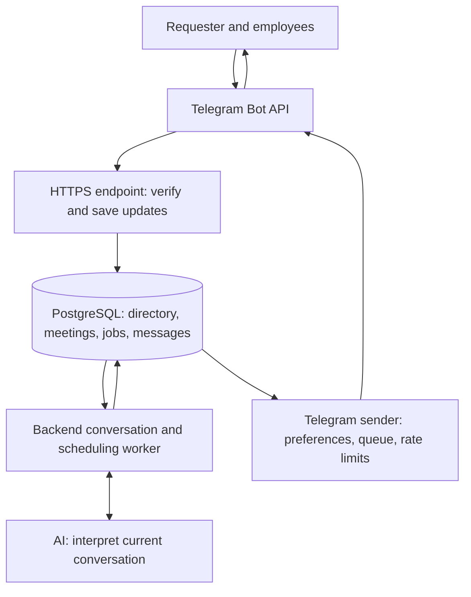

# Telegram Meeting Bot — implementation guide

**Date and pricing check:** 10 November 2026\
**Scope:** one company's employees; standard Telegram Bot API\
**Status:** production architecture proposal, with a local prototype now implemented. Read the [local quickstart](telegram-local-quickstart.md) for the runnable **GPT-6 Luna + SQLite + long polling** version, current costs, supported features, and live-test limitations. The cloud/PostgreSQL/model budget below remains the earlier production example.

This guide covers the whole Telegram version: requirements, account creation, enrollment, server/database design, implementation steps, pricing, problems, and validation. It can be read independently of the [WhatsApp guide](whatsapp-implementation.md).

## 1. What the product does

The organizer opens a private chat with the company bot and requests a meeting:

> Arrange a 30-minute Engineering meeting on Wednesday, 18 November, between 2 and 4 PM, Dhaka time. Everyone must attend, and I am available too.

Our server looks up the team, asks its enrolled members privately about availability, calculates suitable times, and asks the organizer to select a proposal. The bot then obtains the required members' acceptance and reports the result.

**The AI agent runs in our backend.** Telegram carries the messages. Our server controls database access, permissions, scheduling, reminders, and sending.

Example report:

> M-104: Wednesday, 18 November, 2:30–3:00 PM, Dhaka time. Ayesha and Sara accepted; Nabil has not replied. Awaiting confirmation.

Only mark the meeting **confirmed** after the organizer selects a slot and every required attendee accepts that exact version. The first version confirms through chat. Actual calendar invitations require a later calendar integration.

## 2. Requirements before implementation

| Requirement | Who provides it | Why it is needed |
|---|---|---|
| Company-designated Telegram bot owner | Company admin | Create/manage the bot and recover control |
| Bot username and API token | Bot owner through BotFather | Identify the bot and authorize backend requests |
| Employee roster, team membership, organizer permissions | Company admin | Find the right people and authorize outreach |
| Company-issued enrollment process | Admin and implementation team | Link a real employee to the correct Telegram account |
| Each employee starts the private bot chat | Employees | Enable later private bot messages |
| Working hours/days, time zones, holidays, notification preferences | Company admin | Schedule and remind appropriately |
| Backend hosting and PostgreSQL | Implementation team | Run coordination and save progress |
| Public HTTPS endpoint for the chosen webhook deployment | Implementation team | Receive incoming updates; long polling is an alternative |
| Hosted AI account, credentials, and budget if used | Company/implementation team | Interpret natural-language requests and replies |
| Developer skills in Python, SQL, HTTP APIs, deployment, and testing | Implementation team | Build and support the service |
| Support contact and company data/retention policy | Company admin | Explain data sharing and resolve problems |

Telegram documents the free Bot Platform, bot creation, and the requirement for a user to initiate contact. A company group alone does not enable private outreach to each member. [Official bot introduction](https://core.telegram.org/bots)

The standard bot design uses Telegram user/chat identifiers. Collecting an employee's phone number is not necessary for our bot's contact directory. Employee accounts and access to Telegram are still needed.

## 3. Telegram setup procedure

### 3.1 Create the company bot

1. Open the official [BotFather](https://t.me/BotFather) from the designated owner account.
2. Use `/newbot`, choose a display name and available username, and receive the authentication token.
3. Store the token in the company's secret-management process. Decide who can administer or rotate it.
4. Set the description and support information. Register only commands the backend actually implements.
5. Use a separate development bot for tests so test conversations do not mix with employee meetings.

BotFather creation and bot features are documented in the [official feature guide](https://core.telegram.org/bots/features#botfather). The following command list is our proposed application interface:

| Command | Planned behavior |
|---|---|
| `/start` | Begin enrollment or show the member's existing enrollment status |
| `/help` | Explain meeting requests and provide the support contact |
| `/settings` | Show time zone, notification preferences, and working schedule |
| `/schedule` | Begin the meeting request conversation |
| `/status` | Show meetings the employee is authorized to see |
| `/cancel` | Ask which request the authorized organizer wants to cancel |
| `/stop` | Withdraw scheduling notifications and stop future reminders |

These are not implemented commands yet. Natural-language requests should also work. `/start` must not silently reverse a previous opt-out; obtain explicit permission to re-enable notifications.

### 3.2 Configure our backend

Proposed environment settings:

```text
APP_BASE_URL
DATABASE_URL
TELEGRAM_BOT_TOKEN
TELEGRAM_WEBHOOK_SECRET
AI_PROVIDER_API_KEY
AI_MODEL
COMPANY_DEFAULT_TIMEZONE=Asia/Dhaka
```

Use `getMe` to verify that the configured token identifies the expected bot. Standard API requests use an endpoint of this form:

```text
POST https://api.telegram.org/bot{SERVER_SIDE_BOT_TOKEN}/{METHOD}
```

The token is part of the API URL. Redact outbound URLs from HTTP/client/proxy logs. Keep the token out of frontend code, enrollment links, documents, and ordinary employee chats. [Official Bot API](https://core.telegram.org/bots/api)

### 3.3 Choose one update-receiving method

**Chosen production approach: HTTPS webhook.** Expose `POST /webhooks/telegram`, configure `setWebhook` with a random `secret_token`, and verify `X-Telegram-Bot-Api-Secret-Token` before storing events. Initially request `message` and `callback_query` updates. [Webhook reference](https://core.telegram.org/bots/api#setwebhook)

Illustrative setup body; replace every placeholder through secure deployment configuration:

```json
{
  "url": "https://bot.example.com/webhooks/telegram",
  "secret_token": "REPLACE_WITH_RANDOM_DEPLOYMENT_SECRET",
  "allowed_updates": ["message", "callback_query"],
  "drop_pending_updates": false
}
```

**Alternative: long polling.** A continuously running process calls `getUpdates`; public inbound HTTPS is unnecessary for that receiving method. Persist updates before advancing the offset to `last_durably_saved_update_id + 1`. Keep a single polling receiver per bot and remove the webhook before switching. Telegram supports polling or webhooks, used separately. [Official update-receiving guidance](https://core.telegram.org/bots/faq#how-do-i-get-updates)

For either method, use durable ingestion and deduplication. Check real employee replies rather than relying solely on a successful setup API response.

### 3.4 Enroll employees securely

1. Admin creates/activates an employee record and assigns teams and permissions.
2. Company issues a short-lived, single-use enrollment link through a company-controlled channel.
3. Employee opens the link and starts the bot's private chat.
4. Backend verifies company identity, using company login or another independent approved check, before binding the Telegram account. A forwarded link alone must not allow impersonation.
5. Save the Telegram user ID and private chat ID against the internal employee ID. Confirm time zone, working hours, notification preferences, and availability-sharing behavior.

Telegram supports parameterized start links. Our proposed link uses an opaque enrollment code with no raw employee data or API credentials:

```text
https://t.me/{BOT_USERNAME}?start={OPAQUE_ENROLLMENT_CODE}
```

Deep linking is documented in the [official feature guide](https://core.telegram.org/bots/features#deep-linking). The verification and enrollment rules above are our application design. Never bind identity using a display name or username alone.

## 4. Architecture and server responsibilities



Proposed stack: **Python/FastAPI, PostgreSQL, a separate background worker, and a supervised Linux deployment**. A single small VM runs the initial API, worker, and database. Store timed jobs and outgoing messages in PostgreSQL initially; introduce a separate queue service only if actual workload requires it.

| Module | What to implement |
|---|---|
| Telegram adapter | Token configuration, updates, sends, callback acknowledgments, and error handling |
| Identity and permissions | Enrollment, employee mapping, active membership, and requester/team access |
| Conversation handler | Request clarification, meeting context, command routing, and ambiguous replies |
| AI adapter | Structured extraction of intent and availability from relevant context |
| Scheduling engine | Time conversion, overlap, duration checks, preferences, and conflict checks |
| Meeting workflow | Proposals, acceptance, deadlines, cancellation, and organizer reports |
| Durable worker/sender | Timed reminders, bounded retries, rate limits, and restart recovery |
| Admin/operations | Roster maintenance, support inspection, pause controls, and usage tracking |

## 5. Database design and access

**Our server has controlled access to the employee and meeting database.** The backend checks each requester's permissions before reading or updating records. AI receives selected context; the application retains control of database operations.

| Record | Minimum fields |
|---|---|
| Employee | Internal ID, company identity, name, active flag, IANA time zone, work schedule |
| Team/membership | Team ID, employee ID, membership state |
| Telegram identity | Employee ID, Telegram user ID, private chat ID, verified/enrolled flag |
| Enrollment/preferences | Code hash/expiry/use state, identity verification, notification/sharing preferences |
| Meeting | Reference, organizer, subject, duration, date range, response deadline, state, version |
| Attendee | Employee, required/optional, response status, reminder count |
| Availability | Meeting, employee, start/end instants, time zone, source update |
| Proposal/acceptance | Proposal version, exact slot, employee response/time |
| Inbox/outbox/jobs | Bot/update/action keys, payload reference, due time, lease, attempts, API result |
| Audit/usage | Authorized actions, state changes, errors, model tokens, costs |

Keep Telegram identifiers in a suitable numeric/string representation without truncation. Store actual times in UTC, retaining IANA time zones for display and interpretation. Freeze the attendee list when outreach starts; an admin roster edit should not silently add people to an existing request.

Deduplicate by bot identity and `update_id`. Validate button actions against the authenticated Telegram user and the current proposal. Commit meeting changes and corresponding outgoing jobs together.

## 6. Implementing messages, buttons, and scheduling

### 6.1 Event processing

```text
Receive update -> verify -> durably save -> acknowledge
Worker resolves employee and permissions
Load the correct meeting and current state version
Handle structured commands/buttons directly; interpret free text with AI
Validate the proposed update and recheck the state version
Save the meeting change and outbound work in one transaction
Sender rechecks cancellation, preferences, proposal version, and send limits
```

Call AI outside long database locks. Use worker leases, bounded retries, and version checks to prevent stale interpretations overwriting newer replies. Messages concerning multiple active meetings need explicit context or a clarification.

### 6.2 Example confirmation message

Illustrative `sendMessage` JSON, to be produced by our server after checking permissions and meeting state:

```json
{
  "chat_id": "<VERIFIED_PRIVATE_CHAT_ID>",
  "text": "M-104: Please confirm Wednesday, 18 November, 2:30–3:00 PM, Dhaka time.",
  "reply_markup": {
    "inline_keyboard": [
      [
        {"text": "Confirm", "callback_data": "confirm:M104:1:K7p2"},
        {"text": "Decline", "callback_data": "decline:M104:1:B8r3"}
      ]
    ]
  }
}
```

Keep callback data within Telegram's documented 64-byte maximum. Use short action/proposal references or opaque server-side tokens; verify the recipient, action expiry, and proposal version. A token is not a substitute for authorization. Respond to button callbacks using `answerCallbackQuery`, including when rejecting a stale action. [Official button/callback reference](https://core.telegram.org/bots/api#inlinekeyboardbutton)

Prefer plain text initially. Escape generated content correctly before enabling HTML or Markdown formatting. Record returned message identifiers, but do not interpret an accepted send as proof the employee read or accepted the meeting.

### 6.3 AI boundary

For “I am free on 18 November, 2:30–4 PM, Dhaka time,” the AI extracts structured intent, meeting reference, time zone, and availability intervals. Validate the schema, time bounds, employee permissions, and request dates before saving. Relative dates are anchored to the source message timestamp and employee time zone. [Structured-output reference](https://developers.openai.com/api/docs/guides/structured-outputs)

The model can ask clarifying questions; the server calculates overlap and authorizes state changes. Participant text cannot grant admin access or change the recipient list. Buttons, routine reminders, and deterministic status reports require no AI call.

### 6.4 Meeting states and rules

```text
Draft -> Collecting availability -> Options ready -> Confirming -> Confirmed
                    |                                 |
                    +----------> Needs decision <------+

Any active request -> Cancelled when an authorized organizer cancels
```

- Include organizer availability and all required attendees when calculating overlap.
- Require a continuous interval long enough for the requested duration.
- Treat availability and acceptance of a specific proposal as separate facts.
- Preserve pending, declined, unreachable, opted-out, and confirmed states.
- Reconfirm changed slots; reject stale callbacks or ambiguous “yes” replies.
- Before finalizing, check other bot-confirmed meetings and serialize competing finalizations for affected employees. External commitments remain unknown until a calendar connection is added.
- Default reminders: at most one per employee per day across requests, at most two per request, only during configured work hours. Stop after withdrawal, decline, cancellation, or deadline.
- After two negotiation rounds or the response deadline, give the organizer the unresolved decision and blockers.

## 7. Telegram constraints and pricing

### 7.1 Messaging behavior

Employees must first initiate their private bot chat and complete company enrollment. A saved user ID or company group membership alone is insufficient for our verified private outreach process. Use the company directory to select attendees; group enumeration is not a dependency.

Ordinary bot messaging is free within Telegram's standard limits. Telegram documents approximately 30 broadcast messages per second, about one message per second in one chat, and 20 messages per minute in a group. Optional paid broadcasts increase throughput; this pilot leaves them disabled. [Official limits and pricing](https://core.telegram.org/bots/faq#how-do-i-avoid-hitting-limits)

Queue below those limits and honor flood-control `retry_after` responses. Use private scheduling chats; optional group commands can show non-sensitive progress while retaining privacy mode. [API error parameters](https://core.telegram.org/bots/api#responseparameters), [group privacy rules](https://core.telegram.org/bots/faq#what-messages-will-my-bot-get)

### 7.2 Cost lines

| Item | Cost for the proposed design |
|---|---:|
| Telegram bot creation | $0 |
| Normal messages, commands, and callbacks | $0 within standard limits |
| Paid broadcast upgrade | Disabled; $0 budgeted |
| Hosting example | $12/month |
| Daily VM backup example | $3.60/month |
| AI example | $0.10 per meeting under the assumptions below |

Hosting: DigitalOcean Basic Regular, **2 GiB RAM, 1 vCPU, 50 GiB disk, $12/month**, with PostgreSQL on that VM. [Official hosting price](https://www.digitalocean.com/pricing/droplets) Daily percentage-based VM backups add **30%**. [Official backup price](https://docs.digitalocean.com/products/backups/details/pricing/)

Optional AI reference: GPT-5.6 Terra at **$2/million input tokens and $12/million output tokens**. [Official model price](https://developers.openai.com/api/docs/models/gpt-5.6-terra) This is a replaceable budgeting example, not a finding that this model is required or cheapest.

Assume an average of five attendees and 20 AI calls per meeting, including organizer/member conversation handling. Each call averages 1,000 billed input tokens and 250 total billed output tokens, including any reasoning within that output assumption:

```text
AI per call = (1,000 × $2 + 250 × $12) / 1,000,000 = $0.005
AI per meeting = 20 × $0.005 = $0.10
Monthly total = $12 hosting + $3.60 backup + meetings × $0.10
```

No cached-input or batch discounts, voice processing, or paid tool calls are assumed. Token counts and conversation length must be measured during the pilot.

### 7.3 Monthly examples in USD, before taxes

| Meetings | Telegram messaging | Hosting + backup | AI | Total |
|---:|---:|---:|---:|---:|
| 20 | $0.00 | $15.60 | $2.00 | **$17.60** |
| 100 | $0.00 | $15.60 | $10.00 | **$25.60** |
| 300 | $0.00 | $15.60 | $30.00 | **$45.60** |

Free Telegram messaging does not make hosting, AI, development, or support free. Longer AI context, more clarification, or retry traffic can raise the total. Existing company infrastructure could reduce incremental hosting costs, but that is not assumed here.

Excluded: development/maintenance, taxes, FX/card fees, domain purchases, extra backup storage/monitoring, calendar licenses, and usage beyond the token assumptions. No exchange rate, promotional credit, or managed database subscription is included. The single VM is a pilot sizing proposal and a single point of failure.

Recalculate from the project root with `python3 scripts/estimate_costs.py`. Inputs are in [pricing-assumptions.json](pricing-assumptions.json); use its Telegram totals. This calculator does not fetch live rates. If WhatsApp is added later, share the backend and choose one preferred contact channel per employee to avoid duplicate outreach and hosting estimates.

## 8. Problems we may face

| Problem | Example | Implementation response / owner |
|---|---|---|
| A member never started the bot | Nabil is in the group but cannot receive the private request. | Organizer/admin provides enrollment; bot reports enrollment needed and leaves him unconfirmed. |
| The employee cannot use Telegram | Company device policy or access prevents enrollment. | Admin confirms an agreed alternative before including that person in Telegram coordination. |
| Wrong or forwarded enrollment link | Someone tries to enroll as a coworker. | Independently verify company identity; expire/consume enrollment codes and reject impersonation. |
| Username or display name changes | Sara changes her Telegram username. | Use stable linked user ID, not the display name, for authorization. |
| Bot blocked or notification preference withdrawn | A member no longer wants scheduling messages. | Record unreachable/opted-out status, stop outreach, and report the blocker. |
| Wrong token or token rotation | API requests become unauthorized. | Alert the owner, rotate/update through company secret management, then resume eligible work. |
| Polling and webhook both configured | No updates reach the polling worker. | Choose one receiver; inspect webhook configuration before switching modes. |
| Slow or unavailable webhook | Backend processing blocks receipt. | Save quickly, acknowledge, and process in the background; alert on backlog and inspect missed-state gaps after recovery. |
| Flood control | Several reminders target the same employee at once. | Queue by bot/chat limits and honor `retry_after`; keep paid broadcasting disabled. |
| Button belongs to an old proposal | Sara taps an earlier 2:30 confirmation after a time change. | Verify current proposal version and actor; acknowledge the callback and explain that a new response is required. |
| Ambiguous reply or two active requests | “Tomorrow works” or “yes” lacks clear meeting context. | Clarify date, time zone, interval, or meeting reference before changing the schedule. |
| No response or no common time | Required members disagree or stay silent. | Apply bounded reminders/negotiation, then report blockers and request an organizer decision. |
| Duplicate/reordered updates | Telegram retries a callback after a restart. | Deduplicate durably and use meeting version checks; do not apply acceptance twice. |
| Two meetings compete for one slot | The same employee is confirmed in parallel requests. | Recheck confirmed conflicts and serialize finalization for affected employees. |
| Unknown send result | API timeout happens after a message may have been accepted. | Record uncertainty and reconcile rather than blindly duplicating final confirmations. |
| Model error/outage | AI misreads “after lunch” or cannot respond. | Validate extracted fields, ask clarification, retain pending state, and keep deterministic help/status available. |
| Existing calendar conflict | An external appointment was not mentioned. | Explain the first version relies on stated availability; add authorized calendar checks later. |
| Group information exposure | A user asks for private availability in a company group. | Return only permitted progress; continue sensitive coordination in the verified private chat. |

## 9. Implementation phases and completion checks

1. **Bot connection:** create a development bot, verify `getMe`, receive a real private message, and send a response through our server.
2. **Enrollment/directory:** implement roster management, independent employee verification, identity binding, preferences, and requester permissions.
3. **Durable coordination:** implement inbox/outbox/jobs, request clarification, structured extraction, overlap calculation, proposal versions, acceptance, cancellation, and reports.
4. **Telegram interaction:** implement commands, inline buttons, callback acknowledgment, actor/version validation, message/context mapping, rate limits, and failed-send handling.
5. **Pilot:** enroll a small team and coordinate real meetings; measure AI tokens, queue delay, response rate, failures, and actual hosting usage.

Meaningful checks include unregistered members, impersonation attempts, duplicate updates, stale buttons, cancellation before a reminder sends, opt-out, no overlap, daylight/time-zone boundaries, concurrent finalization, blocked bot, AI failure, and recovery after restart.

Acceptance requires that all required participants' explicit acceptance is correctly recorded for one proposal, the organizer can see pending blockers, and a restart preserves progress. No live bot tests have been run by this documentation task.

## 10. Deployment, privacy, and operations

Run the API/receiver and worker as supervised processes with bounded concurrency, migrations, health checks, and persistent storage. Track ingestion age, queue delay, unresolved meetings, send failures, callback errors, model tokens, and budget consumption. Use company-controlled administration and document token rotation and incident recovery.

Store only needed employee/profile information. Show organizers attendance/availability outcomes rather than private explanations. Keep secrets server-side, redact token-bearing URLs, restrict database access, and encrypt disks/backups. Review provider data handling for the selected AI endpoint; no zero-retention guarantee is assumed. [AI data-controls reference](https://developers.openai.com/api/docs/guides/your-data)

Proposed retention: 14 days for raw scheduling messages and 90 days for derived meeting/audit records, subject to company policy and backup handling. Take database-consistent exports, maintain protected off-server recovery copies, and test restoration. The quoted daily VM backup is only one part of recovery.

## 11. Open decisions and documentation

The company must still choose the bot owner/username, roster, organizer access, working schedule/time zones, hosting, AI provider, support contact, identity-verification method, retention rules, and expected meeting volume. Start with one team's private chats; optional group commands and calendar creation can follow.

Official platform and pricing references are linked at the relevant steps. Additional references:

- [FastAPI documentation](https://fastapi.tiangolo.com/) — proposed HTTP framework.
- [PostgreSQL locking reference](https://www.postgresql.org/docs/current/sql-select.html) — primitives for worker claiming and concurrency control.
- [Employee usage guide](whatsapp-and-telegram-usage.md) — requester/member example interactions.
- [Plain-language product plan](architecture-and-pricing.md) — a full worked meeting example.

The Telegram platform, API, BotFather, and pricing references above were accessible on the stated research date. The application architecture, enrollment process, limits on reminders, and AI usage assumptions are our proposed design, not features Telegram supplies automatically.
