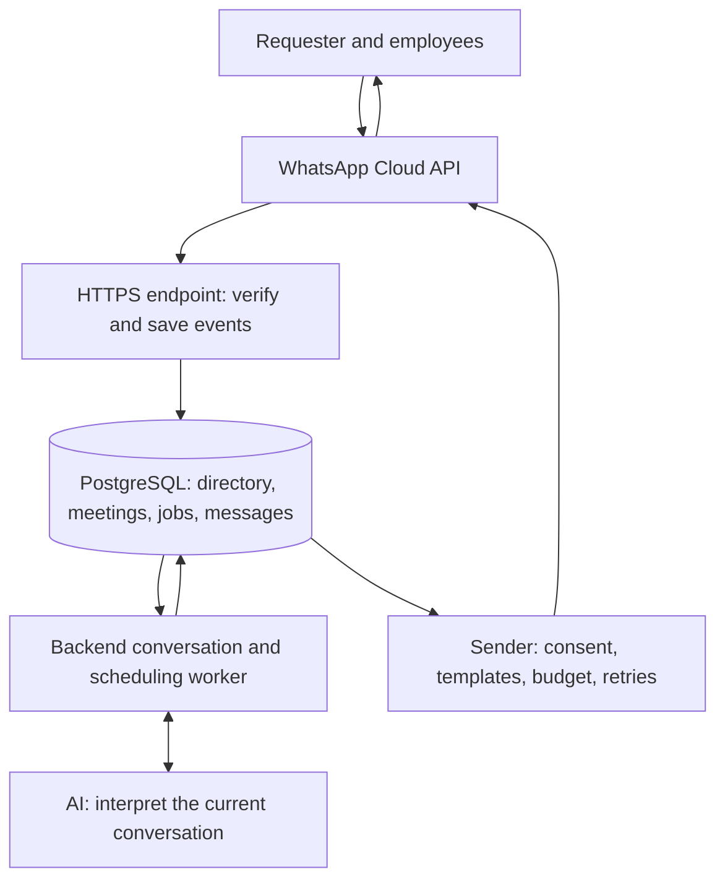

# WhatsApp Meeting Bot — implementation guide

**Date and pricing check:** 10 November 2026\
**Scope:** one company's employees; direct WhatsApp Cloud API integration\
**Status:** proposed implementation. Accounts, credentials, backend, and live messaging have not been configured by this document.

This guide covers the whole WhatsApp version: what it does, prerequisites, setup, backend design, database access, costs, failure cases, and implementation checks. The [Telegram guide](telegram-implementation.md) describes the alternative independently.

## 1. What the product does

A requester messages the company's bot:

> Arrange a 30-minute Engineering meeting on Wednesday, 18 November, between 2 and 4 PM, Dhaka time. Everyone must attend. I am available too.

The backend looks up Engineering in our database, asks its registered members privately, gathers availability, calculates a common time, and obtains acceptance of the chosen proposal. It reports the result to the requester.

**The AI agent runs in our backend.** WhatsApp carries messages; our server controls database access, scheduling, permissions, and sending.

Example outcome:

> M-104: Wednesday, 18 November, 2:30–3:00 PM, Dhaka time. Ayesha and Sara accepted. Nabil has not replied. Awaiting confirmation.

The bot says **confirmed** only after the organizer chooses the slot and every required attendee accepts that exact proposal. The first version sends chat confirmations. Creating an actual calendar event is a later integration.

## 2. Requirements before implementation

| Requirement | Who provides it | Why it is needed |
|---|---|---|
| Company Meta admin/developer access | Company admin | Create and manage the company's messaging assets |
| Meta business portfolio, WhatsApp Business Account, eligible business number | Company admin | Identify the sender and business assets |
| Access to the number's SMS or voice verification | Number owner | Complete ownership verification and registration |
| Company business details, support contact, and published privacy information | Company admin | Account setup, employee notice, and support |
| Employee roster, team membership, and organizer permissions | Company admin | Resolve requests to authorized recipients |
| Verified employee messaging identities and opt-in records | Admin and employees | Enable expected scheduling outreach |
| Working days/hours, time zones, holidays, reminder policy | Company admin | Define acceptable scheduling behavior |
| Backend hosting, database, public HTTPS endpoint | Implementation team | Receive messages and run coordination continuously |
| Approved templates and account billing configuration | Meta account admin | Support proactive requests, reminders, and billable traffic |
| AI API account, credentials, and usage budget, if using a hosted model | Company/implementation team | Interpret conversational requests and replies |
| Developer skills in Python, SQL, HTTP APIs, deployment, and testing | Implementation team | Build and maintain the service |

Meta's accessible [Cloud API reference](https://www.postman.com/meta/whatsapp-business-platform/collection/wlk6lh4/whatsapp-cloud-api) describes the business assets and access-token permissions. Account verification, app review, publishing, and limits must be checked for this company's actual onboarding route; this guide does not assume universal approval requirements.

The [official messaging policy](https://business.whatsapp.com/policy) covers opt-in, privacy information, templates, and human escalation. Initially maintain the company directory through an authenticated admin API or CLI. A polished admin dashboard can follow.

## 3. Meta setup procedure

### 3.1 Create the company assets

1. Sign in to [Meta's developer dashboard](https://developers.facebook.com/apps/) with authorized company access.
2. Create an app and enable the WhatsApp use case/product offered in the dashboard.
3. Associate the app with the correct company business portfolio and WhatsApp Business Account.
4. Use the dashboard's test setup to send a test message to an allowed test recipient and receive a reply.
5. Record the app ID, business/account identifiers, and phone number ID shown by onboarding.

Use [Meta's getting-started guide](https://developers.facebook.com/documentation/business-messaging/whatsapp/get-started) alongside the dashboard. That page required login during this research, so exact menu labels and test-account limits must be checked there during implementation.

### 3.2 Add a production number

Choose a company-controlled number and follow the ownership, registration, display-name, and two-step verification steps required by the selected route. Meta's [registration reference](https://www.postman.com/meta/whatsapp-business-platform/folder/zuoeksl/registration) describes phone verification and registration; parts of the Postman interface may require sign-in.

A dedicated company number is the simplest proposed pilot choice. If reusing an existing number, first check the applicable migration or coexistence route and its eligibility. Preserve the existing account until the correct route is established.

### 3.3 Configure backend credentials

Use a production-appropriate system-user token with only the required permissions and business assets. The accessible [Meta API reference](https://www.postman.com/meta/whatsapp-business-platform/collection/wlk6lh4/whatsapp-cloud-api) describes messaging/management permissions and token types. Monitor expiration and revocation; a long-lived token is not a guarantee of permanent access.

Proposed environment configuration, with secrets stored outside source control:

```text
APP_BASE_URL
DATABASE_URL
META_APP_ID
META_APP_SECRET
WHATSAPP_BUSINESS_ACCOUNT_ID
WHATSAPP_PHONE_NUMBER_ID
WHATSAPP_ACCESS_TOKEN
WHATSAPP_VERIFY_TOKEN
WHATSAPP_GRAPH_API_VERSION
AI_PROVIDER_API_KEY
AI_MODEL
COMPANY_DEFAULT_TIMEZONE=Asia/Dhaka
```

Use the identifiers and supported API version required by the actual account. Log identifiers when useful for diagnosis, but redact tokens, app secrets, and sensitive message content.

### 3.4 Connect incoming messages

Our application exposes:

```text
GET  /webhooks/whatsapp     Subscription challenge
POST /webhooks/whatsapp    Incoming messages and status notifications
```

Configure the public HTTPS callback and verification token. Complete the challenge, subscribe to the required message fields, and ensure the app is subscribed to the WhatsApp account. Meta documents the account subscription through `/{WABA_ID}/subscribed_apps` in its [official collection](https://www.postman.com/meta/whatsapp-business-platform/collection/wlk6lh4/whatsapp-cloud-api).

Validate POST authenticity using `X-Hub-Signature-256` and the app secret over the raw request body. The GET verification token and POST signature serve different purposes. Meta's [archived webhook reference](https://whatsapp.github.io/WhatsApp-Nodejs-SDK/api-reference/webhooks/start/) documents the mechanics; use current API documentation for implementation and do not adopt the archived SDK as a dependency.

Persist authenticated events before acknowledging receipt. Handle messages and delivery/status events separately. A dashboard test succeeding does not by itself prove real employee messages reach our backend.

### 3.5 Templates, billing, and enrollment

Submit purpose-specific templates for meeting outreach, reminders, and final updates. Record the exact approved name, language, variable contract, status, and category. Configure billing and verify account-specific rates. Enroll a few employees and record their consent to scheduling messages and availability summaries.

Example proposed template wording, subject to approval:

> {{company}} meeting request {{reference}} from {{organizer}}: {{duration}} minutes during {{dates}}. Please reply with suitable times or decline. Contact {{support}} for help.

Template creation, variable names, and button formats must follow the chosen API's actual approved structure. This wording is a design example, not a submitted or approved template.

## 4. Architecture and server responsibilities



Proposed stack: **Python/FastAPI, PostgreSQL, a separate background worker, and a supervised HTTPS deployment on one Linux VM**. Keep the first deployment small; no separate queue service is required initially. PostgreSQL stores the inbox, timed jobs, and outbound work.

| Backend module | What to implement |
|---|---|
| WhatsApp adapter | Verify callbacks, normalize messages, send API requests, process delivery/status events |
| Identity and authorization | Link accounts to employees and check requester/team permissions |
| Conversation handler | Track the current request, clarify ambiguous replies, and route meeting references |
| AI adapter | Extract structured intent/availability from relevant conversation context |
| Scheduling engine | Validate intervals, find overlap, rank options, and detect conflicts |
| Meeting workflow | Manage proposals, acceptance, cancellation, deadline outcomes, and organizer reports |
| Job worker/outbound sender | Run reminders, enforce platform rules, retry safely, and recover after restarts |
| Admin and operations | Maintain the roster, inspect failures, review costs, and pause outreach |

## 5. Database design and access

**Our server has controlled read/write access.** Employee and organizer access is checked by backend authorization. AI receives selected context; database credentials remain on our server.

| Record | Minimum fields |
|---|---|
| Employee | Internal ID, name, company identity, active flag, time zone, working schedule |
| Team/membership | Team ID, employee ID, membership status |
| Messaging identity | Employee ID, provider identifier, verification state, preferred channel |
| Permission | Employee, notification/sharing scope, grant source/time, withdrawal |
| Meeting | Reference, organizer, subject, duration, date range, deadline, state, version |
| Attendee | Employee, required/optional, response status, reminder count |
| Availability | Meeting, employee, start/end instants, original time zone, source event |
| Proposal/acceptance | Proposal version, exact slot, employee response and timestamp |
| Inbox/outbox/jobs | Unique event/action key, payload reference, due time, attempts, lease, provider message ID |
| Audit/usage | State changes, delivery/category data, model tokens, estimated/actual costs |

Store instants in UTC and retain IANA time zones for interpretation/display. Use stable internal employee IDs; messaging addresses are linked identities. Snapshot the attendees when outreach begins so roster changes cannot silently alter an active meeting.

Use a unique inbound-message key scoped by channel/account/provider ID. Deduplicate status events separately so an earlier incoming message cannot suppress later delivery updates. Commit meeting changes and corresponding outgoing jobs in one transaction.

## 6. Implementing the conversation and scheduling

### 6.1 Event processing

```text
Receive -> verify -> durably save -> acknowledge
Worker loads employee, permissions, meeting context, and state version
Interpret button/command directly; use AI for free-text interpretation
Validate dates, participants, permissions, and proposed action
Recheck state version and save the update plus outgoing jobs atomically
Sender checks current request state and messaging eligibility before sending
```

Make model/API calls outside long database locks. Use leases and version checks to handle concurrent workers. Retry a state calculation when newer replies invalidate its snapshot.

For each proposed outgoing message, the sender checks opt-in, recipient eligibility, cancellation, quiet hours, budget, latest inbound time, and template status **at send time**.

### 6.2 AI output and authority

The AI might extract the following from a clarified response:

```json
{
  "intent": "availability",
  "meeting_reference": "M-104",
  "time_zone": "Asia/Dhaka",
  "intervals": [
    {"start": "2026-11-18T14:30:00+06:00", "end": "2026-11-18T16:00:00+06:00"}
  ],
  "needs_clarification": false
}
```

Validate output against a schema and the actual request. Relative dates use the message timestamp and employee time zone. Ask about missing time boundaries. Text cannot grant permissions, add unauthorized recipients, or override policy. AI suggests interpretations; server rules authorize actions and calculate times. [Official structured-output reference](https://developers.openai.com/api/docs/guides/structured-outputs)

### 6.3 Meeting states and rules

```text
Draft -> Collecting availability -> Options ready -> Confirming -> Confirmed
                    |                                 |
                    +----------> Needs decision <------+

Any active request -> Cancelled when an authorized organizer cancels
```

- Include the organizer's availability and all required participants.
- Intersect time intervals and require enough continuous time for the duration.
- General availability permits proposals; final acceptance belongs to one exact proposal version.
- Pending, unavailable, declined, unreachable, and opted out remain distinct.
- Check existing bot-confirmed meetings before finalizing; serialize competing finalizations for the affected employees. External calendar conflicts remain unknown until calendars are connected.
- Reconfirm changed slots. Reject stale buttons and ambiguous replies with a clarification.
- Default reminders: at most one per employee per day across requests, at most two per request, during configured working hours. Stop after withdrawal, decline, deadline, or cancellation.
- After two negotiation rounds or the response deadline, return unresolved decisions to the organizer.

### 6.4 Sending messages

Use the chosen Graph API version's message endpoint, conceptually:

```text
POST https://graph.facebook.com/{GRAPH_API_VERSION}/{PHONE_NUMBER_ID}/messages
Authorization: Bearer {SERVER_SIDE_ACCESS_TOKEN}
```

Send a template with its approved parameters when required; send free-form text only when eligible. Treat HTTP acceptance as an API result and record later delivery/status updates separately. Verify concrete payloads against the [official Cloud API examples](https://www.postman.com/meta/whatsapp-business-platform/collection/wlk6lh4/whatsapp-cloud-api) during implementation.

## 7. WhatsApp constraints that shape the product

Opt-in is required. Initiating conversations uses approved templates. Free-form replies are permitted within 24 hours of the recipient's latest message; sending a template alone does not restart that clock. Provide a human contact and honor opt-outs. [Official messaging policy](https://business.whatsapp.com/policy)

**Example:** Sara replies Monday at 9 AM. An ordinary conversational reminder on Wednesday is outside that window. The sender must use an appropriate approved template or report that outreach is blocked.

The pilot uses individual chats and the company directory. Existing group membership and Groups API access are not dependencies. A sent or read message does not establish meeting acceptance.

Meta's terms restrict some uses whose primary offering is AI technology. We intend a dedicated scheduling service assisted by AI; acceptance for this account must still be checked. The indexed [Business Solution Terms](https://www.whatsapp.com/legal/business-solution-terms/) were available, while the full page required login. This document does not establish platform approval.

## 8. Pricing and budget

### 8.1 Confidence and rates

**WhatsApp rates below are provisional provider-reported estimates for Bangladesh recipient numbers.** Meta's accessible public overview describes delivery/category/market pricing but still includes free-message language that conflicts with providers' October 2026 billing updates. The detailed Meta rate card required login. Verify rates and classifications in the company account before committing spend. [Meta overview](https://business.whatsapp.com/products/platform-pricing), [detailed rate card](https://developers.facebook.com/documentation/business-messaging/whatsapp/pricing)

| Item | Planning value |
|---|---:|
| Incoming member messages | No Meta message fee reported |
| Delivered utility template | $0.0037 |
| Delivered marketing template | $0.0732 |
| Delivered service reply after allowance | $0.0037 |
| Reported service allowance | 1,000 messages per bot number per month |

Country rates: [MsgOrb Bangladesh publication](https://www.msgorb.com/whatsapp-pricing/bangladesh). Allowance/billing change: [Gupshup October notice](https://support.gupshup.io/hc/en-us/articles/62362400519705-WhatsApp-Service-Messages-Pricing-w-e-f-01-Oct-2026). These provider publications are not substitutes for an account-level Meta quote. Our design includes no provider subscription.

The approved category matters: utility and marketing are different billing categories. A meeting invitation must not be assumed to qualify as utility. Record category changes and reconcile delivered traffic with actual billing.

### 8.2 Hosting and AI assumptions

- VM example: DigitalOcean Basic Regular, 2 GiB RAM, 1 vCPU, 50 GiB disk, **$12/month**. PostgreSQL runs on the same VM. [Official hosting price](https://www.digitalocean.com/pricing/droplets)
- Daily VM backup example: **30%**, or **$3.60/month**. Hosting plus backup is **$15.60/month**. [Official backup pricing](https://docs.digitalocean.com/products/backups/details/pricing/)
- Optional AI example: GPT-5.6 Terra, **$2/million input tokens and $12/million output tokens**. [Official model pricing](https://developers.openai.com/api/docs/models/gpt-5.6-terra)

Per meeting, assume five attendees, 10 templates, 20 service replies, and 20 AI calls. Each call averages 1,000 billed input tokens and 250 total billed output tokens, including any reasoning within that assumption. AI cost is `(1000 × 2 + 250 × 12) / 1,000,000 × 20 = $0.10` per meeting. Counts are estimates; reminders, confirmations, and rescheduling can require more traffic. No caching or batch discounts are assumed.

### 8.3 Monthly examples in USD, before taxes

| Meetings | Hosting + backup | AI | Messages: utility case | Messages: marketing case | Total: utility case | Total: marketing case |
|---:|---:|---:|---:|---:|---:|---:|
| 20 | $15.60 | $2.00 | $0.74 | $14.64 | **$18.34** | **$32.24** |
| 100 | $15.60 | $10.00 | $7.40 | $76.90 | **$33.00** | **$102.50** |
| 300 | $15.60 | $30.00 | $29.60 | $238.10 | **$75.20** | **$283.70** |

The utility case prices all 10 templates per meeting as utility; the marketing case prices all as marketing. Both use the same service count and reported monthly allowance. These are sensitivity examples, not a guaranteed range or maximum bill. If the allowance is unavailable, add $1.48, $3.70, or $3.70 respectively.

```text
Message cost = utility_count × utility_rate
             + marketing_count × marketing_rate
             + max(0, service_count − allowance) × service_rate
```

For multiple numbers or recipient markets, use the actual applicable billing buckets. Preserve effective rate dates and actual provider classifications in the usage ledger.

Excluded: engineering/maintenance, taxes, FX/card fees, SIM/number and domain costs, provider markups, extra backup storage/monitoring, existing calendar licenses, and usage above the token/message assumptions. No exchange rate or promotional credit is assumed. The small VM is a pilot sizing proposal with a single point of failure.

Recalculate from the project root with `python3 scripts/estimate_costs.py`. Inputs are in [pricing-assumptions.json](pricing-assumptions.json); the calculator does not fetch live rates.

## 9. Problems we may face

| Problem | Example | Implementation response / owner |
|---|---|---|
| Account onboarding blocked | Meta asks for additional verification. | Admin completes account-specific requirements; keep the pilot on the test setup until eligible. |
| Existing number has another setup | The company's number already serves customers. | Admin/developer verify the migration or coexistence route before modifying that account. |
| Test webhook works but real replies are absent | Dashboard tests succeed; Sara's replies never arrive. | Developer checks the actual account subscription, fields, number/account IDs, permissions, HTTPS reachability, and account restrictions. |
| Expired or revoked token | Sending suddenly becomes unauthorized. | Alert admin; refresh through the approved credential process and retry eligible work after recovery. |
| Wrong template status/category | Outreach is rejected or billed differently. | Stop affected jobs, inspect current approval/category, and update templates and budget. |
| Reply window closes while queued | A draft reply waits until the next day. | Sender rechecks eligibility at execution and uses an approved template if appropriate. |
| Member did not opt in or opted out | A new employee was added only to the roster. | Admin completes permission/enrollment; do not treat roster membership as messaging permission. |
| Delivery failure or blocked bot | Nabil cannot be reached. | Record unreachable status; inform the organizer instead of implying acceptance. |
| No response or no overlap | Sara is silent, or available times conflict. | Bounded reminders/negotiation, then a clear organizer decision with blockers. |
| Ambiguous identity/time | Two Saras; “tomorrow afternoon.” | Resolve employee identity and full dates/time zones before recording a definite answer. |
| Two active meetings | “Yes” could refer to M-104 or M-105. | Use message context/reference; otherwise ask which meeting. |
| Proposal changes | A 2:30 meeting moves to 4 PM. | Invalidate old acceptance and ask required attendees to accept the new version. |
| Duplicate or reordered events | A reply is retried or an old status arrives late. | Deduplicate and apply monotonic/versioned transitions. |
| Restart or uncertain send | Server stops after provider acceptance. | Resume durable jobs; investigate ambiguous sends before duplicating final messages. |
| Model misunderstanding or outage | AI invents an end time or becomes unavailable. | Validate fields; ask clarifications; retain pending state and provide deterministic status/help. |
| Another calendar commitment | A person forgot an external event. | Check bot-confirmed conflicts now; add authorized external free/busy checks later. |
| Excess cost or notification volume | Too many retries or reminders. | Bound retries, cap reminders, pause new outreach at configured application limits, and reconcile bills. |

## 10. Implementation phases and completion checks

1. **Account proof:** test outbound and real inbound messages; establish current registration, token, template, and billing requirements. Complete when a permitted message round trip is visible in our server records.
2. **Directory and storage:** implement migrations, enrollment, authorization, inbox/outbox, and meeting/proposal records. Complete when an outsider cannot impersonate a member or requester.
3. **Coordination:** implement clarification, AI extraction, interval matching, confirmation, deadline reports, and cancellation. Complete with a real multi-person meeting example and a no-overlap example.
4. **WhatsApp sending rules:** implement consent/window/template checks, status processing, bounded retries, reminder caps, and usage tracking. Complete when an out-of-window queued message is handled correctly.
5. **Small production pilot:** use the company number and approved templates with enrolled employees. Compare real delivery categories, token usage, and billing with assumptions.

Meaningful checks include duplicate callbacks, cancellation before a queued reminder, stale proposal acceptance, concurrent finalization, cross-time-zone dates, opt-out, failed delivery, invalid signatures, and recovery after restart. Document live account tests separately from automated application checks.

## 11. Deployment, privacy, and operations

Run the API and worker as supervised services with health checks, bounded concurrency, database migrations, and durable storage. Monitor incoming-event age, queue delay, unresolved meetings, send errors, token failures, AI tokens, and spend.

Use HTTPS, restricted database access, encrypted disks/backups, log redaction, and company-authorized admin access. Share availability outcomes with the requester, while keeping private explanations out of reports. Review AI-provider data handling for the actual endpoint; do not promise zero retention by default. [OpenAI data controls](https://developers.openai.com/api/docs/guides/your-data)

Proposed retention: 14 days for raw scheduling messages and 90 days for derived meetings/audit records, subject to company policy and backup handling. Take database-consistent exports, protect off-server recovery copies, and test restoration. The quoted VM backup is not a complete tested database recovery plan.

## 12. Open decisions and documentation

The company still needs to provide the roster, organizer permissions, work schedule/time zones, number choice, account access, hosting preference, support contact, retention policy, and expected volume. Calendar provider selection is a later decision.

Primary references are linked at the relevant steps. Additional implementation references:

- [FastAPI documentation](https://fastapi.tiangolo.com/) — proposed HTTP framework.
- [PostgreSQL locking reference](https://www.postgresql.org/docs/current/sql-select.html) — primitives for durable job claiming and concurrency control.
- [WhatsApp template categorization](https://developers.facebook.com/documentation/business-messaging/whatsapp/templates/template-categorization) — required account/template check; retrieval was blocked during research.
- [Original source verification register](technical-reference.md#7-documentation-and-verification-register) — accessible, login-restricted, and provisional sources.
- [Employee usage guide](whatsapp-and-telegram-usage.md) — proposed requester/member interactions.

No account registration, live message, or calendar booking has been performed by this guide. Completion requires the implementation checks and account-level validation above.
