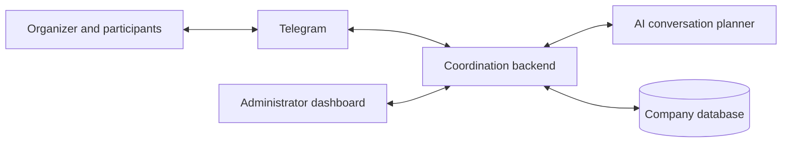

# Telegram Meeting Bot: Workflow and Architecture

The meeting bot helps employees arrange meetings through Telegram. It collects availability, finds a suitable time, and reports the confirmed details to the organizer.

## Workflow

1. **Prepare the company directory.** The administrator adds teams and employees through the web dashboard. Employees connect their Telegram accounts and receive admin approval.
2. **Request a meeting.** The organizer messages the bot with the team or people, meeting duration, and preferred date/time range.

   > “Arrange a 30-minute meeting with the Management team tomorrow between 10 am and 12 pm.”

3. **Review the request.** The bot identifies the attendees and shows the meeting details. It asks for clarification where needed. The organizer approves before anyone is contacted.
4. **Collect availability.** The bot privately asks each participant when they are available. Participants reply naturally in Telegram.
5. **Find a common time.** The backend compares responses, considers working hours and time zones, and offers matching slots to the organizer.
6. **Confirm the selected slot.** The organizer chooses a time. The bot asks the other required participants to accept or decline that exact slot.
7. **Report the result.** Once everyone required accepts, the bot sends the final meeting details to the organizer and participants. The organizer can also check progress while responses are pending.

Saved conversation context helps the bot understand follow-up replies and corrections without asking for the same details again. If no common time is found, someone declines, or responses are missing, the bot asks for alternatives or informs the organizer that a decision is needed.

**Current scope:** confirmation happens through Telegram. Calendar invitations and video-meeting links are not created automatically.

## Architecture

| Component | Role |
|---|---|
| **Telegram** | The interface employees use to request meetings, share availability, and confirm a time. |
| **Coordination backend — Python** | Controls the workflow, checks permissions, finds matching times, tracks responses, and sends messages. |
| **AI planner — GPT-6 Luna** | Understands natural-language messages using saved context and proposes the next action. The backend validates and carries it out. |
| **Database — SQLite** | Stores employees, teams, linked Telegram accounts, conversation context, availability, and meeting status. |
| **Administrator dashboard** | Manages company members and settings, starts/stops the bot, and displays meeting progress. |

**Telegram delivers the messages; our backend and AI planner handle the conversation and coordination.** The current backend and database run on a company computer, which must remain running and connected to the internet.
